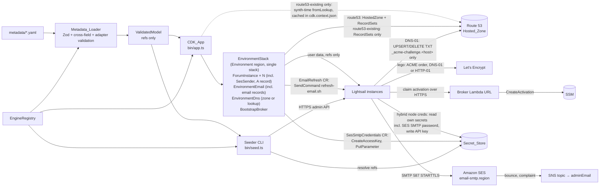
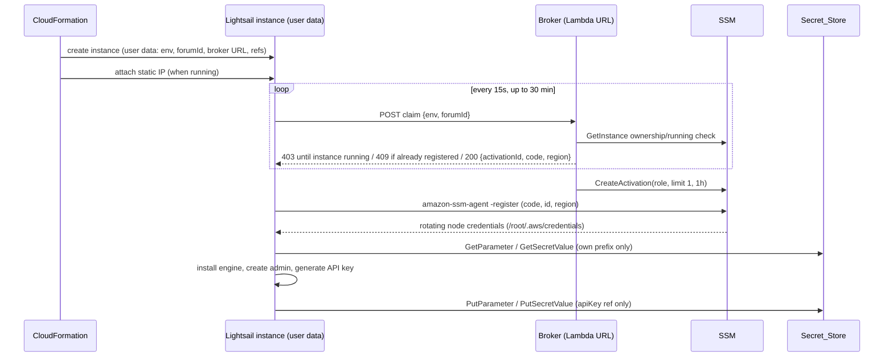

# Design Document: Lightsail Forum Platform

## Overview

The Lightsail Forum Platform is a TypeScript monorepo with three layers fed by a single validated model:

1. **Metadata_Loader** (`src/metadata/`) parses one YAML Metadata_File with Zod into an immutable `ValidatedModel` that carries Secret_References, never secret values.
2. **CDK_App** (`bin/app.ts`, `src/infra/`) turns the model into one CloudFormation stack per Environment: per-forum Lightsail instance, static IP, firewall, auto-snapshots, IAM node role, a lifecycle custom resource for final snapshots, per-forum SES sending identity (IAM user, send-only policy, SMTP credential custom resource), an Environment-level bootstrap broker, Environment-level SES resources (Email_Identity, Configuration_Set, bounce/complaint SNS topic), and, in the Route53_Modes, Route 53 DNS: a Platform-created public hosted zone (`route53`) or a validated lookup of an operator-owned zone (`route53-existing`), carrying forum A records and email authentication records. Route 53 is global, so everything lives in this single stack in the Environment region; there is no companion stack.
3. **Seeder** (`bin/seed.ts`, `src/seeder/`) reads actual forum state over HTTPS, computes a plan with a pure reconciler, and executes it through the engine's seed client.

TLS certificates are issued and renewed on each instance by one engine-agnostic certificate manager in the shared user-data prelude (a pinned, checksum-verified `lego` binary). It uses the ACME DNS-01 challenge through Route 53 in the Route53_Modes and HTTP-01 otherwise, and hands the certificate to the engine through paths and a reload command the adapter declares.

All engine-specific behaviour (minimum RAM, blueprint, install script, email refresh script, TLS capability, engine option validation, seed operations) lives behind `EngineAdapter` and is reached only through `EngineRegistry`.

All forum email goes through Amazon SES. The metadata declares only a Sender_Address per forum (plus optional `mailDomain`, `dmarcPolicy`, `credentialRotation`); the SMTP host, port and credentials are derived by the Platform. There is no generic SMTP configuration.

### Key design decisions

| Topic | Decision |
|---|---|
| Instance credentials (Req 2.6) | SSM hybrid activation, issued on demand by a per-Environment **bootstrap broker** that binds the claim to the forum's static IP. The activation code is never stored in templates, user data, tags, outputs or at rest. See [Instance credentials](#decision-instance-credentials). |
| Node role scope | Per-forum IAM role with an inline least-privilege policy. `AmazonSSMManagedInstanceCore` is **not** attached because it grants `ssm:GetParameter*` on `*`. |
| API key write-back (Req 5.5, 6.5) | Generated on the instance after install, written with `aws ssm put-parameter` / `aws secretsmanager put-secret-value` reading the value from a `0600` file on tmpfs (`file://`), never from argv or logs. |
| Minimum RAM (Req 4.5) | Static bundle table `src/metadata/bundles.ts` maps `bundleId` to RAM. Loader compares against `adapter.minRamMb`. Unknown bundle ids are rejected. |
| DNS (Req 3.2, 3.3, 4.3, 12) | Route 53 only, all in the single Environment stack (Req 12.13). `route53`: L2 `PublicHostedZone` for `rootDomain`, removal policy `DESTROY`. `route53-existing`: synth-time `HostedZone.fromLookup` by `rootDomain` (public only), compared with the declared `hostedZoneId`; the zone itself is never a stack resource. Records are L2 `ARecord` / `CnameRecord` / `MxRecord` / `TxtRecord`, TTL 300, `deleteExisting: false`, construct IDs derived from forum id or record id. `external`: no Route 53 resources, record name/value outputs instead. See [Route 53 DNS](#decision-route-53-dns). |
| TLS (Req 5.3, 6.3, 13) | One shared certificate manager in the user-data prelude: pinned `lego` release verified by SHA-256, certificates under `/etc/community-hub/tls/<hostname>/`. DNS-01 through Route 53 with the hybrid-node credentials when the DNS_Mode is a Route53_Mode and the adapter declares `tls.dns01`; HTTP-01 otherwise. The first certificate is issued **before** the engine starts. Renewal by a systemd timer twice a day. See [TLS certificates](#decision-tls-certificates). |
| Node role Route 53 scope (Req 13.6–13.8) | DNS-01 forums only: `route53:ChangeResourceRecordSets` on their own zone, conditioned to `UPSERT`/`DELETE` of `TXT` at `_acme-challenge.<hostname>`; `route53:ListResourceRecordSets` on the zone; `route53:GetChange` on `change/*`. No `ListHostedZones*` because lego gets the zone id from `AWS_HOSTED_ZONE_ID`. HTTP-01 forums get no Route 53 action. |
| Snapshots (Req 3.7, 4.7) | Lightsail auto-snapshot add-on at the declared hour. Because Lightsail deletes automatic snapshots with their instance, a per-forum `ForumLifecycle` custom resource takes a **manual** final snapshot on delete; manual snapshots are outside the stack and therefore retained. |
| Naming (Req 3.5, 3.6) | `${env}-${forumId}-<resource>` from `naming.ts`. Forum ids are narrowed to `^[a-z][a-z0-9]{0,19}$` so names are injective across Environments. |
| Seeder | Reconcile: read → pure `plan()` → `execute()`. Dry-run stops after `plan()`. Never deletes entities. Membership of declared groups is authoritative. |
| SES identity (Req 11.1, 11.2, 11.11–11.13) | `AWS::SES::EmailIdentity` for the Mail_Domain in the Environment region (Easy DKIM, MAIL FROM `mail.<Mail_Domain>`, default Configuration_Set), `AWS::SES::ConfigurationSet`, an event destination for bounce and complaint to an SNS topic with an email subscription to `adminEmail`. No configuration-set suppression override, so the account-level suppression list applies. See [Amazon SES email](#decision-amazon-ses-email). |
| Email DNS (Req 11.3–11.5) | Pure `buildEmailDnsRecords()` yields 3 DKIM CNAMEs, MAIL FROM MX + SPF TXT and DMARC TXT. In the Route53_Modes each becomes one L2 record in the Hosted_Zone, with DKIM names and targets taken from the identity's GetAtts in the same stack; `external` mode outputs them. |
| SES credentials (Req 11.7–11.9) | Per-forum IAM user with an inline send-only policy conditioned on `ses:FromAddress`. A `SesSmtpCredentials` custom resource creates the access key, derives the SMTP password in-Lambda (pure, tested SigV4 derivation) and writes it as an SSM SecureString under the forum prefix. Only the access key id leaves the Lambda, and the response is `NoEcho`. |
| Credential rotation (Req 11.15, 11.16) | Physical id embeds the rotation counter, so a counter change replaces the resource: new key and password first, then an `EmailRefresh` custom resource pushes the change to the instance via SSM Run Command, then CloudFormation cleanup deletes the old key. A boot-time refresh unit covers offline instances. |

## Architecture



### Layer boundaries

- `src/metadata/` is the only code that reads YAML. `bin/app.ts` and `bin/seed.ts` call `loadMetadataFile()` and pass the `ValidatedModel` on.
- `src/infra/` never calls forum APIs and never resolves secret values at synthesis. It only places Secret_References into user data and IAM policy resource ARNs. The one place that handles an SES secret is the `SesSmtpCredentials` Lambda at deploy time, which holds the secret access key in memory only long enough to derive and store the SMTP password.
- `src/seeder/` never calls Lightsail, CloudFormation or IAM. It reads secrets through `SecretResolver`.
- `src/seeder/reconciler.ts`, `src/seeder/desired.ts`, `src/metadata/*`, adapter `renderInstallScript()` / `renderEmailRefreshScript()`, `src/infra/email/{smtp-password,sender-policy,email-dns-records}.ts`, `src/infra/dns/zone-check.ts`, `src/infra/tls/{challenge,acme-policy}.ts` and `src/infra/user-data/tls.ts` are pure (no I/O, no clock, no randomness).
- `src/infra/` makes no AWS SDK calls of its own. The only AWS read at synthesis is CDK's built-in hosted-zone context lookup in `route53-existing` mode, performed by the CDK toolkit and cached in `cdk.context.json`.
- `src/infra/`, `src/seeder/` and `src/metadata/` import only `src/engines/engine-adapter.ts` types and receive an `EngineRegistry` by injection. Only `src/engines/registry.ts` (`createDefaultRegistry`) imports `engines/discourse` and `engines/flarum`.

### Repository layout

Extends the steering layout; new files are marked `+`.

```
bin/
  app.ts                       # CDK entry: -c metadata=<path>
  seed.ts                      # Seeder CLI (commander)
src/
  metadata/
    schema.ts                  # Zod schema (single source of truth), z.infer types
    secret-ref.ts              # parse/format Secret_Reference
    bundles.ts               + # Lightsail bundleId -> RAM table
    validate.ts              + # cross-field + adapter validation -> ValidationIssue[]
    mail.ts                  + # pure: mail domain / sender address checks and expansion, checkDns(), sesSettings()
    loader.ts                  # loadMetadata(text, registry) / loadMetadataFile(path, registry)
    errors.ts                + # MetadataValidationError
  engines/
    engine-adapter.ts          # EngineAdapter, SeedSupport, SeedClient contracts
    registry.ts                # EngineRegistry + createDefaultRegistry()
    seed-client.ts           + # composeSeedClient(handlers): dispatch by ResourceType
    discourse/
      adapter.ts  options.ts  install-script.ts  seed-client.ts  versions.ts
    flarum/
      adapter.ts  options.ts  install-script.ts  seed-client.ts  versions.ts
  infra/
    environment-stack.ts       # one Stack per Environment (all resources, incl. Route 53)
    forum-instance.ts          # L3: instance + static IP + firewall + node role + lifecycle + A record
    dns/                     +
      environment-dns.ts       # L3: PublicHostedZone (route53) or validated fromLookup (route53-existing); zone outputs
      zone-check.ts            # pure: checkLookedUpZone(declaredId, lookedUpId, rootDomain)
      records.ts               # L2 record factories: forumARecord(), emailRecords() (exhaustive switch on record type)
    tls/                     +
      challenge.ts             # pure: selectChallenge(dnsMode, adapter.tls) -> 'dns-01' | 'http-01'
      acme-policy.ts           # pure: buildAcmeDnsStatements() for the node role
    bootstrap-broker.ts      + # L3: broker Lambda + function URL
    email/                   +
      environment-email.ts     # L3: EmailIdentity, ConfigurationSet, event destination, SNS topic + policy + subscription
      ses-sender.ts            # L3 per forum: IAM user, inline policy, SesSmtpCredentials CR, EmailRefresh CR
      email-dns-records.ts     # pure: buildEmailDnsRecords()
      sender-policy.ts         # pure: buildSesSenderPolicy()
      smtp-password.ts         # pure: deriveSesSmtpPassword() (SigV4-based)
    node-role.ts             + # pure policy document builder + Role construct
    firewall.ts              + # pure buildPortRules()
    naming.ts                  # deterministic names
    user-data/
      prelude.ts             + # shared bash: logging, swap, docker, aws cli, ssm registration, fetch_secret, wait_for_dns
      tls.ts                 + # pure: renderTlsScript() -> lego install, issue_certificate, deploy hook, renew timer
      versions.ts            + # shared pins: lego version + SHA-256
      compose.ts             + # Fn.join header (broker URL token, hosted zone id token) + prelude + tls + adapter script
    handlers/                + # Lambda handlers (bundled with NodejsFunction)
      bootstrap-broker.ts
      forum-lifecycle.ts       # onDelete: final snapshot, deregister node, delete activations
      ses-smtp-credentials.ts  # create/rotate/delete access key, derive + store SMTP password
      email-refresh.ts         # restore-if-needed + SSM Run Command refresh-email.sh, poll result
  seeder/
    types.ts                 + # seeder domain types from the data-model steering (ResourceType, SeedResource, PlanAction, ...)
    desired.ts               + # pure: ForumModel -> SeedResource[]
    normalize.ts             + # shared normalizers (also used by adapters for actual state)
    reconciler.ts              # pure: plan()
    executor.ts                # execute()
    report.ts                  # summarize(), exitStatus(), formatReport()
    run.ts                   + # runSeed(): orchestrates per forum
  shared/
    secrets.ts                 # SecretResolver (SSM / Secrets Manager)
    logger.ts                  # structured logger + Redactor
    http.ts                    # HTTPS-only fetch wrapper, timeouts, 429 backoff
    errors.ts                + # typed errors except MetadataValidationError (see Typed errors)
metadata/example.yaml
test/                          # mirrors src/; test/support/fake-forum.ts, fake-http.ts, arbitraries.ts
test/integration/              # opt-in, COMMUNITY_HUB_INTEGRATION=1
```

## Decision: Instance credentials

### Problem

Lightsail instances cannot assume IAM instance profiles. Each forum must, at first boot, read its own SES SMTP password and admin/database secrets and write its generated API key (Req 2.6, 5.5, 6.5), while no secret value may appear in templates or user data (Req 2.5). Whatever credential bootstraps the instance is itself sensitive and must reach the instance somehow.

### Options evaluated

| Criterion | A. Per-forum IAM user + access key | B. SSM hybrid activation, code in user data | C. SSM hybrid activation, code claimed from IP-bound broker (**chosen**) |
|---|---|---|---|
| Credential lifetime | Long-lived static keys; manual rotation | Code single-use, short expiry; node creds auto-rotated by SSM agent | Same as B |
| Delivery path | Secret key must reach instance: via `CfnAccessKey` GetAtt into user data (resolved value lands in user data and stack events) or a vending service | Code via GetAtt into user data; visible in resolved user data and CloudFormation events | Code generated at claim time, returned once over TLS to a caller the broker authorizes by verifying the forum's own Lightsail instance exists and is running in this account (ownership), plus single-registration-per-forum and a 1-hour expiry. Never at rest. |
| Req 2.5 / steering "user data only holds Secret_References" | Violated unless a vending service is added | Violated | Satisfied: user data holds only the broker URL and forum id |
| Blast radius if leaked | Usable from anywhere until revoked (mitigable with `aws:SourceIp`) | Anyone with the code before first registration can register a node with the forum role | Code is issued only while the forum's instance is running and only once per forum (single registration, 1-hour expiry); a leaked code is unusable once the real node has registered |
| Extra capabilities | None | Session Manager, Run Command, inventory | Same as B; also lets operators re-run the install script remotely and skip SSH entirely |
| Cost / complexity | IAM user per forum, key rotation runbook | Custom resource for `CreateActivation` (no CFN resource exists) | One small Lambda per Environment plus function URL |

IAM Roles Anywhere was also considered and rejected: it needs a CA and a private key on the instance, which reintroduces the same delivery problem plus PKI management.

**Decision: C.** It keeps the steering choice (hybrid activation, single-use, short expiry, per-forum role) and fixes the delivery problem without placing the activation code in any CloudFormation-visible location.

### Bootstrap broker

One `BootstrapBroker` construct per Environment:

- Lambda (`nodejs22.x`) with a function URL, `authType: NONE`. **Security note:** the endpoint is unauthenticated at the HTTP layer. Authorization is **account ownership of the claimed forum's Lightsail instance**: the broker verifies via `GetInstance` that the forum's instance exists and is in the `running` state in this account before issuing an activation. (An earlier design bound authorization to `requestContext.http.sourceIp == staticIp`; this is unsound on Lightsail because an instance's **outbound** traffic is NAT'd through a Lightsail-managed address that is not its attached static IP, so the source IP of the claim never equals the static IP. The ownership check replaces it.) The primary anti-replay controls are **single active registration per forum** and the **1-hour activation expiry**: once the real node registers, any further claim returns 409, and an unclaimed code expires in an hour. Additional controls: Zod-validated body, generic `403/404/409` responses that do not reveal which check failed, activation code never logged (redactor registers it before any log call).
- Configuration via environment variable `FORUMS` (JSON, non-secret): `{ [forumId]: { staticIpName, roleName, defaultInstanceName } }`, where `staticIpName` and the instance name are deterministic resource names (never a resolved address or a CDK token). The 4 KB Lambda environment limit allows roughly 25 forums per Environment; the CDK_App fails synthesis with a clear error beyond that.
- IAM: `ssm:CreateActivation`, `ssm:DeleteActivation`, `ssm:DescribeActivations`, `ssm:DescribeInstanceInformation`, `ssm:AddTagsToResource`, and `iam:PassRole` on the Environment's node role ARNs (built deterministically from the stack account/partition, not a GetAtt, to avoid a broker↔instance dependency cycle) with condition `iam:PassedToService = ssm.amazonaws.com`. Plus `lightsail:GetInstance` on `Resource: "*"` for the ownership check — per the Lightsail Service Authorization Reference `GetInstance` and `GetStaticIp` are Read actions that support no resource type, so `*` is the tightest grant IAM permits.

Claim algorithm (`POST {brokerUrl}` with body `{ "environment": "<env>", "forumId": "<id>" }`):

1. Parse body; look up forum in `FORUMS`. Unknown → 404.
2. `GetInstance(<env>-<forumId> instance name)`; if the instance does not exist or is not in the `running` state → 403 (ownership/readiness check — replaces the former source-IP equality check, which is unsound on Lightsail).
3. `DescribeActivations(DefaultInstanceName = <env>-<forumId>)` → activation ids. `DescribeInstanceInformation(ActivationIds)`; if any node is registered → 409 (single registration per forum).
4. Delete any prior unused activations for this forum.
5. `CreateActivation({ IamRole: roleName, RegistrationLimit: 1, ExpirationDate: now + 1h, DefaultInstanceName, Tags: [community-hub:environment, community-hub:forum] })`.
6. Return `200 { activationId, activationCode, region }` (no `observedIp`: the claim source IP is a NAT address and carries no authorization meaning).

**Residual exposure (accepted).** The claim authorizes the *forum*, not the *caller*: the function URL is unauthenticated and the ownership check proves only that the forum's own instance exists and is `running` in this account. Any party that can reach the URL and knows a valid `environment` + `forumId` can therefore cause an activation to be minted while that forum has no registered node. What bounds the exposure:

- **Single registration per forum.** Once the legitimate node registers, every later claim returns 409 and no new activation is issued. An attacker must win the race against the booting instance, which claims within seconds of first boot.
- **One-hour expiry and `RegistrationLimit: 1`.** An activation that is minted but not used is useless after an hour and can register at most one node.
- **Identifiers are not secrets but are not published.** `environment` and `forumId` are non-secret, yet they appear only in the metadata file, resource names and the instance's own user data, never in public DNS or outputs.
- **Blast radius of a hijacked registration.** The registered node assumes only the per-forum node role: read its own `/community-hub/<env>/<forumId>/*` secrets, write its own API key, and (DNS-01) change its own `_acme-challenge` TXT record. It cannot reach another forum's secrets (explicit `NotResource` deny) and holds no IAM user key.
- **Detectability.** Every issued activation logs `activation issued` with the activation id (never the code), and a lost race surfaces as the legitimate instance receiving 409 and failing its install with a clear reason.

*Decision:* accepted for this threat model (a community forum whose node role exposes only that forum's own secrets). It would not be acceptable if the node role were broader. *Considered and not adopted:* rejecting claims for instances older than a boot window using `GetInstance.createdAt`, which would narrow the race further but would also block legitimate re-claims after a failed or interrupted install, so it is left as a future hardening option should the node role ever gain broader permissions.



### Node role (per forum)

Built by pure `buildNodePolicy(env, forum, account, region, partition)` in `node-role.ts` so it can be unit-tested without synthesis.

- Trust: `ssm.amazonaws.com` with `aws:SourceAccount = <account>` and `aws:SourceArn = arn:<partition>:ssm:<region>:<account>:*`.
- Agent core (replaces `AmazonSSMManagedInstanceCore`): `ssm:UpdateInstanceInformation`, `ssm:ListInstanceAssociations`, `ssm:DescribeAssociation`, `ssm:GetDocument`, `ssm:UpdateInstanceAssociationStatus`, `ssmmessages:{Create,Open}{Control,Data}Channel`, `ec2messages:{AcknowledgeMessage,DeleteMessage,FailMessage,GetEndpoint,GetMessages,SendReply}`.
- Read: `ssm:GetParameter`, `ssm:GetParameters` on `arn:…:parameter/community-hub/<env>/<forumId>/*`; `secretsmanager:GetSecretValue` on `arn:…:secret:/community-hub/<env>/<forumId>/*`. This already covers the Platform-managed `ses-smtp-password` (SecureString) and `ses-smtp-username` (String) parameters, so SES needs no extra node permission. The instance never holds SES IAM credentials; it authenticates to SES with SMTP credentials only.
- Write: `ssm:PutParameter` on exactly the `apiKey` parameter ARN, or `secretsmanager:PutSecretValue` on exactly the `apiKey` secret (`<name>-??????`).
- Route 53 (DNS-01 forums only, from `buildAcmeDnsStatements()`; see [Node role Route 53 statements](#node-role-route-53-statements)): change only the forum's own `_acme-challenge` TXT record in the Environment's Hosted_Zone. HTTP-01 forums get no Route 53 statement.
- Defense in depth: an explicit `Deny` on `ssm:GetParameter*` and `secretsmanager:GetSecretValue` with `NotResource` = the forum prefix. (An earlier design also pinned every statement with `aws:SourceIp = <static IP>/32`; this is removed because a Lightsail instance's outbound traffic egresses from a NAT address that is not its static IP, so such a condition would deny every legitimate call. Least privilege is carried entirely by exact resource ARNs scoped to the forum's `/community-hub/<env>/<forumId>/` prefix and the forum's own `_acme-challenge` record.)
- KMS: AWS managed keys (`aws/ssm`, `aws/secretsmanager`) are assumed; their key policies authorize use through the service, so no `kms:*` statement is needed. Customer managed keys are out of scope.

The loader enforces that every forum-level Secret_Reference id starts with `/community-hub/<env>/<forumId>/` (both stores; for Secrets Manager ARNs the name segment is checked). This is what makes path-prefix IAM scoping sufficient for Req 2.6. The names `ses-smtp-password` and `ses-smtp-username` under that prefix are reserved for the Platform; a declared reference that uses them is rejected so the credentials custom resource never overwrites an operator secret.

## Decision: Amazon SES email

### Environment SES resources (`EnvironmentEmail`, Environment region)

| Construct ID | CloudFormation type | Key properties |
|---|---|---|
| `Email/Identity` | `AWS::SES::EmailIdentity` | `EmailIdentity: <Mail_Domain>`; `DkimAttributes.SigningEnabled: true` (Easy DKIM, no BYODKIM); `MailFromAttributes: { MailFromDomain: mail.<Mail_Domain>, BehaviorOnMxFailure: USE_DEFAULT_VALUE }`; `ConfigurationSetAttributes.ConfigurationSetName: <config set>`. Attributes `DkimDNSTokenName1..3` and `DkimDNSTokenValue1..3` feed the DKIM CNAMEs. |
| `Email/ConfigurationSet` | `AWS::SES::ConfigurationSet` | `Name: names.configurationSet(env)`; `ReputationOptions.ReputationMetricsEnabled: true`; `SendingOptions.SendingEnabled: true`; **no** `SuppressionOptions`, so the account-level suppression list governs bounced and complained addresses (Req 11.13). |
| `Email/Topic` | `AWS::SNS::Topic` | `TopicName: names.emailTopic(env)`. Not SSE-encrypted: SES can publish to an encrypted topic only with a customer managed key, which is out of scope. Messages contain recipient addresses and bounce metadata, no credentials. |
| `Email/TopicPolicy` | `AWS::SNS::TopicPolicy` | Allow `ses.amazonaws.com` `sns:Publish` on the topic with `StringEquals AWS:SourceAccount = <account>` and `ArnLike AWS:SourceArn = arn:<partition>:ses:<region>:<account>:configuration-set/<config set>`. |
| `Email/AdminSubscription` | `AWS::SNS::Subscription` | `Protocol: email`, `Endpoint: adminEmail`. Requires manual confirmation from the inbox (README, sandbox output). |
| `Email/BounceComplaint` | `AWS::SES::ConfigurationSetEventDestination` | `ConfigurationSetName`; `EventDestination: { Name: bounce-complaint, Enabled: true, MatchingEventTypes: [bounce, complaint], SnsDestination.TopicARN }`; depends on `TopicPolicy` so SES can validate publish access at creation. |

`Tags.of()` applies to every resource whose CloudFormation type accepts tags; the tag assertion test lists exempt types explicitly (as it already does for `CfnStaticIp`).

An SES domain identity is unique per account and region. Two Environments in the same account and region therefore need distinct Mail_Domains (for example `mailDomain: staging.example.org`). The loader cannot see other Environments, so this is documented and surfaces as a CloudFormation "already exists" error.

Changing `mailDomain` replaces the identity and its DKIM tokens. Because identity and records share one stack, CloudFormation creates the new identity and its records and then deletes the old ones in a single deployment.

### Email DNS records (`email-dns-records.ts`)

```ts
/** Discriminated by type so the Route 53 factory can switch exhaustively. Names are absolute (trailing dot). */
export type EmailDnsRecord =
  | { readonly id: 'Dkim1' | 'Dkim2' | 'Dkim3'; readonly type: 'CNAME'; readonly name: string; readonly target: string }
  | { readonly id: 'MailFromMx'; readonly type: 'MX'; readonly name: string; readonly priority: 10; readonly host: string }
  | { readonly id: 'MailFromSpf' | 'Dmarc'; readonly type: 'TXT'; readonly name: string; readonly text: string };
/** Pure: the single-line value shown in external-mode outputs (`10 host`, unquoted TXT text, CNAME target). */
export function displayValue(record: EmailDnsRecord): string;
/** Pure: email authentication records for one Environment, in a fixed order. */
export function buildEmailDnsRecords(input: {
  mailDomain: string; mailFromDomain: string; region: string; adminEmail: string;
  dmarcPolicy: 'none' | 'quarantine' | 'reject';
  dkim: readonly [DkimToken, DkimToken, DkimToken];   // { name, value } from identity GetAtts
}): readonly EmailDnsRecord[];
```

| id | name | type | value |
|---|---|---|---|
| `Dkim1..3` | `` `${DkimDNSTokenNameN}.` `` | CNAME | `DkimDNSTokenValueN` |
| `MailFromMx` | `mail.<Mail_Domain>.` | MX | priority `10`, host `feedback-smtp.<region>.amazonses.com` |
| `MailFromSpf` | `mail.<Mail_Domain>.` | TXT | `v=spf1 include:amazonses.com ~all` |
| `Dmarc` | `_dmarc.<Mail_Domain>.` | TXT | `v=DMARC1; p=<dmarcPolicy>; rua=mailto:<adminEmail>` |

- Route53_Modes (Req 11.3): `emailRecords(scope, zone, records)` in `dns/records.ts` switches on `type` (exhaustive, `never` check) and creates, under `Email/Dns/<id>`, a `CnameRecord`, `MxRecord` or `TxtRecord` in the Hosted_Zone with `ttl: Duration.seconds(300)` and `deleteExisting: false`. The DKIM name and target are GetAtts of `Email/Identity` in the same stack, so no cross-region mechanism is involved.
- Names are absolute (trailing dot). The L2 records append the zone name to any `recordName` that does not end with `.` or with the zone name, and a token never matches either test, so `${tokenName}.` is the only safe form for the DKIM names. CloudFormation resolves it to `Fn::Join [<name>, "."]`.
- TXT values are passed unquoted; `TxtRecord` adds the surrounding quotes and splits strings over 255 characters into multiple quoted strings, as Route 53 requires. Both values here are under 255 characters for any valid admin email, and a unit test asserts the synthesized `ResourceRecords` (for example `"\"v=spf1 include:amazonses.com ~all\""`).
- The loader guarantees the Mail_Domain is the root domain or a subdomain of it, so every record belongs to the one Hosted_Zone.
- `external` mode (Req 11.4): one triple of outputs per record under `Email/Dns<id>`: `Email<id>Name`, `Email<id>Type`, `Email<id>Value` (`displayValue()`).
- DMARC aggregate reports to an `adminEmail` outside the Mail_Domain need an authorization record at the receiving domain (RFC 7489 §7.1). The README notes this; the Platform does not create it.

### Per-forum sending identity (`SesSender`, under `Forum-<id>`)

| Construct ID | Resource | Key properties |
|---|---|---|
| `Ses/User` | `AWS::IAM::User` | `UserName: names.sesUser(env, forumId)`, `Path: /community-hub/<env>/`, tags. No console password, no managed policies. |
| `Ses/SendPolicy` | `AWS::IAM::Policy` (inline on the user) | from `buildSesSenderPolicy()` |
| `Ses/Credentials` | `CustomResource` (`SesSmtpCredentials`) | properties `UserName`, `Region`, `ParameterPrefix`, `RotationCounter`; depends on `User` and `SendPolicy` |
| `Ses/Refresh` | `CustomResource` (`EmailRefresh`) | properties `Environment`, `ForumId`, `AccessKeyId` (`GetAtt Credentials.AccessKeyId`); depends on `Credentials` |

`Instance` depends on `Ses/Credentials` so both parameters exist before first boot.

```ts
/** Pure: least-privilege SES send policy for one forum. */
export function buildSesSenderPolicy(input: {
  partition: string; region: string; account: string;
  mailDomain: string; configurationSetName: string; senderAddress: string;
}): PolicyDocumentJson;
```

One statement: `Effect: Allow`, `Action: [ses:SendEmail, ses:SendRawEmail]`, `Resource: [arn:<p>:ses:<region>:<acct>:identity/<Mail_Domain>, arn:<p>:ses:<region>:<acct>:configuration-set/<config set>]`, `Condition: { StringEquals: { 'ses:FromAddress': <Sender_Address> } }`. The configuration-set ARN is included because SES authorizes the default configuration set as a second resource of the send; it grants no other capability. No wildcards. Sender addresses are unique per Environment (loader rule), so no forum can send as another (Req 11.7).

### SES_Settings

Derived in `mail.ts`; nothing here is declared in metadata:

```ts
export interface SesSettings {
  readonly host: string;                    // email-smtp.<region>.amazonaws.com
  readonly port: 587;                       // STARTTLS
  readonly senderAddress: string;           // expanded, lowercased
  readonly usernameParameter: string;       // /community-hub/<env>/<forumId>/ses-smtp-username (String, value = access key id)
  readonly passwordParameter: string;       // /community-hub/<env>/<forumId>/ses-smtp-password (SecureString, aws/ssm)
}
export function sesSettings(environment: EnvironmentModel, forum: ForumModel): SesSettings;
```

The SMTP username (access key id) is not a secret, but it is stored in SSM rather than passed into user data. That keeps `UserData` free of deploy-time tokens that change on rotation, so rotation never touches the instance resource (Req 11.16, Property 18).

### SMTP password derivation (`smtp-password.ts`)

```ts
/** Pure: SES SMTP password for a secret access key, per the AWS-documented algorithm. */
export function deriveSesSmtpPassword(secretAccessKey: string, region: string): string;
```

```
k1 = HMAC-SHA256("AWS4" + secretAccessKey, "11111111")
k2 = HMAC-SHA256(k1, region)
k3 = HMAC-SHA256(k2, "ses")
k4 = HMAC-SHA256(k3, "aws4_request")
k5 = HMAC-SHA256(k4, "SendRawEmail")
password = base64(0x04 || k5)              // 33 bytes -> 44 base64 chars
```

Uses `node:crypto` only. Unit-tested against a fixed vector (an AWS-published one if available, otherwise one produced with AWS's documented reference script for a placeholder key and checked into the test) and by Property 22.

### `SesSmtpCredentials` custom resource (`handlers/ses-smtp-credentials.ts`)

One provider per Environment (`onEvent` only), one resource per forum. Dependencies (`iam`, `ssm` clients, `sleep`, logger) are injected for tests.

Physical id: `${env}-${forumId}-ses-r${RotationCounter}-${AccessKeyId}`. The counter makes a counter change a replacement; the access key id (non-secret) tells the later Delete which key it owns.

- **Create** (first deploy, forum add, or replacement after a counter change):
  1. `ListAccessKeys(UserName)`. IAM allows at most two keys per user. If two exist, delete any key that is not the one currently named in `ses-smtp-username` (orphans of a failed run). If two remain, fail: `user <name> already has 2 access keys; delete the stale key and redeploy`.
  2. `CreateAccessKey` → `{ AccessKeyId, SecretAccessKey }`. The secret is registered with the handler's redactor immediately.
  3. `password = deriveSesSmtpPassword(SecretAccessKey, Region)`.
  4. `PutParameter(ses-smtp-password, SecureString, Overwrite: true)`, no `KeyId`, so the AWS managed `aws/ssm` key is used. Then `LabelParameterVersion(ses-smtp-password, version, [AccessKeyId])` so this password can be restored later. Then `PutParameter(ses-smtp-username, String, Overwrite: true, Value: AccessKeyId)`.
  5. Drop references to the secret and password. Return `{ PhysicalResourceId, Data: { AccessKeyId }, NoEcho: true }`.
- **Update** with the same counter (no other property changes in practice): return the existing physical id; no IAM or SSM calls (Req 11.16).
- **Update** with a different counter: same as Create, returning the new physical id. CloudFormation then sends Delete for the old id in the cleanup phase.
- **Delete**: parse the key id from the physical id. `DeleteAccessKey` (ignore `NoSuchEntity`). If `ses-smtp-username` equals this key id **and** the user has no other key, this is forum removal or stack destroy: delete both parameters (ignore `ParameterNotFound`). Otherwise the parameters belong to a newer key and are left alone. CloudFormation then deletes `SendPolicy` and `User` (Req 11.17).

Secret handling (Req 11.9): the secret access key and password exist only in Lambda memory; they are never in properties, `Data`, physical ids, logs or errors. SDK errors are mapped to messages built from operation name and error code only. `NoEcho` additionally masks the response.

IAM for the provider: `iam:CreateAccessKey`, `iam:DeleteAccessKey`, `iam:ListAccessKeys` on `arn:<p>:iam::<acct>:user/community-hub/<env>/*`; `ssm:GetParameter`, `ssm:PutParameter`, `ssm:DeleteParameter`, `ssm:LabelParameterVersion` on `arn:<p>:ssm:<region>:<acct>:parameter/community-hub/<env>/*/ses-smtp-*`.

### Rotation without email outage (`EmailRefresh`, `handlers/email-refresh.ts`)

Provider with `onEvent` + `isComplete` (total timeout 30 min). Physical id `${env}-${forumId}-email-refresh`.

- **Create**: no-op, `Data.RefreshStatus = initial`. The install script configures email from the current parameters.
- **Update** (the `AccessKeyId` property changed, either rotation or rollback):
  1. Restore if needed: if `ses-smtp-username` ≠ `AccessKeyId`, read `ses-smtp-password:<AccessKeyId>` (label selector) and re-put both parameters. This covers rollback, where CloudFormation updates this resource back to the old key id before deleting the new credentials.
  2. Wait 10 s (injected `sleep`) for IAM key propagation.
  3. Find the node: `DescribeActivations(DefaultInstanceName = <env>-<forumId>)`, then `DescribeInstanceInformation(ActivationIds)`. If there is no node or `PingStatus ≠ Online`, return `RefreshStatus = node-offline`.
  4. `SendCommand(DocumentName: AWS-RunShellScript, InstanceIds: [node], Parameters.commands: ['/opt/community-hub/bin/refresh-email.sh'], TimeoutSeconds: 1500)`. The command line has no secret; the script prints only `email settings applied|unchanged`.
  5. `isComplete` polls `GetCommandInvocation` until a terminal state: `Success` → `RefreshStatus = applied`; otherwise `RefreshStatus = failed` with the status (no output text).
- **Delete**: no-op.

The resource never fails the deploy because of the instance. Each forum's `RefreshStatus` is a stack output; `failed` means the README's manual refresh applies (run the script through Session Manager or Run Command).

IAM for the provider: `ssm:GetParameter`, `ssm:PutParameter`, `ssm:LabelParameterVersion` on the same `ses-smtp-*` ARNs; `ssm:DescribeActivations`, `ssm:DescribeInstanceInformation`, `ssm:GetCommandInvocation` on `*` (no resource-level support); `ssm:SendCommand` on `arn:<p>:ssm:<region>::document/AWS-RunShellScript` and on `arn:<p>:ssm:<region>:<acct>:managed-instance/*` with `StringEquals aws:ResourceTag/community-hub:environment = <env>` (activation tags propagate to hybrid nodes).

**Rotation sequence** (Req 11.15):

```mermaid
sequenceDiagram
  participant CFN as CloudFormation
  participant C as SesSmtpCredentials (new)
  participant R as EmailRefresh
  participant SS as SSM parameters
  participant I as Instance (refresh-email.sh)
  participant O as SesSmtpCredentials (old)
  CFN->>C: Update, counter n+1 → new physical id
  C->>C: CreateAccessKey (key 2 of 2), derive password
  C->>SS: put password (label key2), put username=key2
  CFN->>R: Update AccessKeyId=key2
  R->>I: SendCommand refresh-email.sh
  I->>SS: fetch username + password
  I->>I: apply (Discourse restart / Flarum SQL + cache clear)
  R-->>CFN: RefreshStatus=applied
  CFN->>O: Delete (cleanup phase)
  O->>O: DeleteAccessKey key1; params ≠ key1, keep
```

Both keys are valid until the instance has switched, so the only interruption is the Discourse container restart.

**Choice: delete the old key in cleanup even when the refresh is not confirmed.** Keeping the old key until a confirmed refresh was rejected:

- Req 11.15 requires deleting the previous key.
- With the two-key IAM limit, an old key that is never deleted blocks the next rotation.
- CloudFormation cleanup failures do not roll back, so gating Delete on refresh success would leave orphan keys without stopping anything.

The gap this leaves is covered on the instance. A boot-time systemd unit runs `refresh-email.sh` before the forum containers start, so an offline instance picks up the new password when it comes back. Only `RefreshStatus = failed` (node online, script failed) needs operator action.

### On-instance email configuration

`EngineAdapter.renderEmailRefreshScript(input)` returns the engine-specific body of `/opt/community-hub/bin/refresh-email.sh` (`0700`). The install script writes it, installs `community-hub-email-refresh.service` (oneshot, `After=docker.service network-online.target`, `WantedBy=multi-user.target`), and calls it with `--no-restart` for the initial configuration. The script is shared-prelude based (`set -euo pipefail`, same log file, ERR trap):

1. `fetch_secret ssm <usernameParameter> /run/community-hub/ses-user` and `fetch_secret ssm <passwordParameter> /run/community-hub/ses-pass` (tmpfs, `0600`).
2. `sha256sum` of both files compared with `/var/lib/community-hub/state/email.sha256` (`0600`). Equal → log `email settings unchanged`, `shred -u`, exit 0. This keeps boot-time runs cheap.
3. Apply (engine-specific, below), write the new hash, `shred -u` the temp files.

**Discourse**: `app.yml` env holds `DISCOURSE_SMTP_ADDRESS=email-smtp.<region>.amazonaws.com`, `DISCOURSE_SMTP_PORT=587`, `DISCOURSE_SMTP_ENABLE_START_TLS=true`, `DISCOURSE_SMTP_USER_NAME` and `DISCOURSE_SMTP_PASSWORD` (placeholders replaced from the temp files by the `python3` JSON-encoding step, no argv), and `DISCOURSE_NOTIFICATION_EMAIL=<Sender_Address>`. No `X-SES-CONFIGURATION-SET` header is needed, because the Configuration_Set is the identity's default. Restart: `./launcher destroy app && ./launcher start app`. `launcher start` passes the env from `app.yml` to `docker run`, so no rebuild is needed (about 1–2 min downtime). Falling back to `./launcher rebuild app` is an item to verify. `--no-restart` only rewrites `app.yml`, since the install script's first `rebuild` follows.

**Flarum**: SQL upsert into `settings` piped via stdin to `docker compose exec -T db mysql`: `mail_driver=smtp`, `mail_host=email-smtp.<region>.amazonaws.com`, `mail_port=587`, `mail_encryption=tls`, `mail_username`, `mail_password`, `mail_from=<Sender_Address>`. Then `docker compose exec -T app php flarum cache:clear`. No downtime. The SQL is generated with values read from the temp files and escaped by a `python3` helper, never placed in argv.

Lightsail does not restrict outbound TCP 587 (only port 25 is throttled), so the firewall needs no change.

## Decision: Route 53 DNS

Route 53 is a global service whose resources can be declared from a stack in any region, so every DNS resource sits in the single `EnvironmentStack` (Req 12.13). Static IPs, DKIM tokens and the zone id are ordinary same-stack references. Domain registration is out of scope: the operator registers `rootDomain` beforehand and, in `route53` mode, delegates it to the new zone's name servers.

### Per-mode resources (`dns/environment-dns.ts`, construct id `Dns`)

| DNS_Mode | Zone | Records | Outputs |
|---|---|---|---|
| `route53` | `Dns/Zone`: `route53.PublicHostedZone({ zoneName: rootDomain })`, `applyRemovalPolicy(RemovalPolicy.DESTROY)`, tagged | A per forum, six email records | `HostedZoneId`, `HostedZoneNameServers` = `Fn.join(',', zone.hostedZoneNameServers!)` (Req 10.2) |
| `route53-existing` | `HostedZone.fromLookup(this, 'Dns/Zone', { domainName: rootDomain, privateZone: false })`, validated against `hostedZoneId`; **no** `AWS::Route53::HostedZone` resource | A per forum, six email records | `HostedZoneId` (declared) |
| `external` | none | none | per-forum A record name/value, 18 email outputs |

`EnvironmentDns` exposes `zone: IHostedZone | undefined` and `zoneId: string | undefined` (a token in `route53` mode, the declared literal in `route53-existing`). `ForumInstance` and `EnvironmentEmail` receive it as a prop; `external` mode passes `undefined` and they create no record.

### Records (`dns/records.ts`)

- Forum A record: `new ARecord(forum, 'Dns/A', { zone, recordName: hostname + '.', target: RecordTarget.fromIpAddresses(staticIp.attrIpAddress), ttl: Duration.seconds(300), deleteExisting: false })`. Its construct path is `Forum-<id>/Dns/A`, so adding or removing a forum adds or removes exactly that record set (Req 4.3, 12.12).
- Email records: under `Email/Dns/<recordId>` as described in [Email DNS records](#email-dns-records-email-dns-recordsts).
- `deleteExisting: false` (the L2 default, set explicitly) means CDK adds no custom resource that deletes a pre-existing record. CloudFormation's `AWS::Route53::RecordSet` create then submits a `CREATE` change, which Route 53 rejects with `Tried to create resource record set [name='<name>', type='<type>'] but it already exists`. The deploy fails and rolls back without modifying the existing record (Req 12.9). This behaviour is an item to verify.
- CloudFormation updates and deletes only the record sets it owns, so `route53-existing` never touches operator records or the zone (Req 12.8, 12.11). The `_acme-challenge` TXT records are written and removed by lego on the instance, not by the stack, and only within the node role scope below.

### `route53` mode: destroy behaviour

Every record references the zone (`HostedZoneId: Ref Dns/Zone`), so CloudFormation deletes all Platform_Records before the zone (Req 12.10). The removal policy stays `DESTROY`, because Req 12.10 requires removing the zone. `RETAIN` was rejected: it would leave a billed zone behind and would make a later deploy with the same `rootDomain` create a second zone with different name servers.

Failure mode: Route 53 refuses to delete a zone that still holds records other than its SOA and NS, for example records the operator added by hand or an `_acme-challenge` TXT left by an interrupted lego run. The stack then ends in `DELETE_FAILED` with `HostedZoneNotEmpty`, and only the zone remains. The README documents the recovery: delete the extra records, then re-run `cdk destroy`. Operators who want to manage other records should use `route53-existing`.

### `route53-existing` mode: zone validation

| | A. Synth-time `HostedZone.fromLookup` (**chosen**) | B. Deploy-time custom resource calling `GetHostedZone(Id)` |
|---|---|---|
| Mechanism | CDK toolkit's built-in hosted-zone context provider looks up the public zone named `rootDomain`; the construct compares its id with `hostedZoneId` | Lambda reads the zone by id; every record depends on it |
| New dependency | None | `@aws-sdk/client-route-53` (not approved) |
| Before any record is created | Yes: a mismatch fails synthesis, before any deployment starts | Yes: records depend on the validator |
| Reports what Req 12.6 asks (declared id, found id, root domain) | Yes | Yes |
| Credentials | Needed at synthesis (first synth, or after a context reset) | Only at deploy |
| Staleness | Result cached in `cdk.context.json`; if the zone is deleted and recreated, `cdk context --reset <key>` is needed | Always current |

Option A is chosen because it meets Req 12.6 and 12.7 without a new dependency.

Algorithm in `EnvironmentDns`:

1. `const zone = HostedZone.fromLookup(...)`. The stack must have a concrete `env.account` and `env.region`, which `bin/app.ts` sets from `CDK_DEFAULT_ACCOUNT` and the metadata.
2. While the context value is missing, CDK returns the dummy id `DUMMY`. The check is skipped in that case, because the toolkit runs the lookup and synthesizes again.
3. Otherwise `checkLookedUpZone({ declaredId, lookedUpId: zone.hostedZoneId, rootDomain })` (pure, `zone-check.ts`) strips a `/hostedzone/` prefix from both ids and compares them. On mismatch it throws `HostedZoneMismatchError`: `hosted zone <declaredId> is not the public hosted zone for <rootDomain> (found <lookedUpId>)`, which reports the declared Hosted_Zone_ID, the found hosted zone ID and the root domain (Req 12.6). `bin/app.ts` maps this error to exit code 2.
4. If no public zone named `rootDomain` exists (the declared zone is missing, or it is private), the lookup provider fails and CDK reports the lookup failure, naming `rootDomain` and `privateZone: false`. Synthesis stops with a non-zero status before any record is created (Req 12.7). The README maps this message to the declared `hostedZoneId`.
5. The zone object is used only as the `zone` of record constructs. Nothing calls `applyRemovalPolicy` on it, and the template contains no `AWS::Route53::HostedZone`.

Tests seed the context in `new App({ context: { [key]: { Id: '/hostedzone/Z…', Name: 'example.org.' } } })`, computing `key` with `ContextProvider.getKey` so they do not hard-code the key format. Synthesis needs no credentials or network.

## Decision: TLS certificates

Lightsail certificates and non-exportable ACM certificates cannot be installed on a Lightsail instance, so each instance obtains its own Let's Encrypt certificate.

### Options evaluated

| | A. Shared host-level `lego` (**chosen**) | B. Per-engine ACME (`web.letsencrypt.ssl`, Caddy automatic HTTPS) |
|---|---|---|
| DNS-01 through Route 53 | lego's built-in `route53` provider | Discourse's acme.sh template has no Route 53 integration; Caddy needs a custom build with the third-party `caddy-dns/route53` module |
| Code paths | One issuance/renewal path, one IAM shape, one log format for every engine | Two engine-specific paths with different retry, renewal and logging behaviour |
| New engine (XenForo) | Declares cert paths and a reload command | Brings its own ACME client |
| Supply chain | One pinned release binary checked against a pinned SHA-256 | Pinned images, but a custom Caddy build is unpinned upstream code |
| Cost | Bash in the prelude plus two systemd units | Less code for HTTP-01 only |

**Decision: A.** Both shipped adapters accept externally supplied certificates, so neither falls back. As Req 6.3 states, the Flarum reverse proxy (Caddy) serves the certificate that the host certificate manager obtains and renews under Requirement 13, and reloads it after each renewal.

### Engine TLS capability (`EngineAdapter.tls`)

```ts
/** How an engine consumes certificates from the shared certificate manager (Req 13.2). */
export interface TlsSupport {
  /** True when the engine serves certificates from certPaths, which enables DNS-01 in Route53_Modes. */
  readonly dns01: boolean;
  /** Host paths the engine reads. The deploy hook installs fullchain (0644) and privkey (0600) here. */
  readonly certPaths: { readonly fullchain: string; readonly privkey: string };
  /** Run after a renewed certificate is installed. Must be idempotent and safe while the engine is running. */
  readonly reloadCommand: string;
  /** Host directory the engine's port-80 server exposes only under /.well-known/acme-challenge/. */
  readonly http01Webroot: string;
}
```

An adapter whose engine cannot read external certificates sets `dns01: false` and still uses the shared manager through HTTP-01 (Req 13.4); `test/support` has a fake `testengine` adapter with `dns01: false` that exercises this path.

Challenge selection (pure, `tls/challenge.ts`):

```ts
/** dns-01 iff the DNS_Mode is a Route53_Mode and the adapter supports it (Req 13.3–13.5). */
export function selectChallenge(dnsMode: DnsMode, tls: TlsSupport): 'dns-01' | 'http-01';
```

| Engine | `dns01` | `certPaths` | `reloadCommand` | Port-80 server |
|---|---|---|---|---|
| Discourse | `true` | `/var/discourse/shared/standalone/ssl/ssl.crt`, `/var/discourse/shared/standalone/ssl/ssl.key` (container `/shared/ssl/ssl.{crt,key}`, as read by the `web.ssl` template) | `docker exec app sv reload nginx` | container nginx; challenge location added by an `app.yml` `run: replace` hook |
| Flarum | `true` | `/etc/community-hub/tls/<hostname>/fullchain.pem`, `privkey.pem` (directory mounted read-only into Caddy as `/certs`) | `docker compose -f /opt/community-hub/flarum/docker-compose.yml exec -T proxy caddy reload --config /etc/caddy/Caddyfile --force` | Caddy `http://<hostname>` site |

Files are copied rather than bind-mounted individually because a single-file bind mount keeps the old inode after an atomic rename. Discourse reads its certificate from its one shared volume, so the hook copies into it. `caddy reload` skips unchanged configuration, so `--force` is needed for Caddy to re-read the certificate files.

### Certificate manager (`user-data/tls.ts`, pure `renderTlsScript(input)`)

```ts
export interface TlsScriptInput {
  readonly hostname: string;
  readonly adminEmail: string;            // ACME account email
  readonly challenge: 'dns-01' | 'http-01';
  readonly staging: boolean;              // environment.acmeStaging
  readonly tls: TlsSupport;               // from the adapter
}
```

The rendered bash, placed after the prelude and before the adapter script, does this:

- **Install lego.** Download the pinned release tarball (`versions.ts`: version and SHA-256 for `linux_amd64`) over HTTPS and check it with `sha256sum -c`, failing with `fail "lego checksum mismatch"` on a mismatch. Install it to `/usr/local/bin/lego` and skip all of this if the version already matches.
- **Write `/etc/community-hub/tls.env`** (`0600`): `CH_TLS_CHALLENGE`, `CH_TLS_SERVER` and, for DNS-01, the lego route53 variables. Issuance and renewal both source this file, so a renewal always uses the same challenge type as the issuance (Req 13.10).
  - DNS-01: `AWS_HOSTED_ZONE_ID=$CH_HOSTED_ZONE_ID` (so lego does not search zones), `AWS_SHARED_CREDENTIALS_FILE=/root/.aws/credentials`, `AWS_PROFILE=default` (written by the SSM agent for the hybrid node), `AWS_REGION=us-east-1` (Route 53 signing region), `AWS_PROPAGATION_TIMEOUT=600`, `AWS_POLLING_INTERVAL=10`, `AWS_TTL=60`.
  - `CH_TLS_SERVER` is the Let's Encrypt staging directory when `acmeStaging` is true and production otherwise.
- **Common lego flags:** `--accept-tos --email <adminEmail> --domains <hostname> --key-type ec256 --path /var/lib/community-hub/lego --server $CH_TLS_SERVER`, then the challenge flags:
  - DNS-01: `--dns route53`;
  - HTTP-01 at issuance: `--http --http.port :80` (lego's own listener) when nothing listens on port 80, otherwise `--http --http.webroot <http01Webroot>`;
  - HTTP-01 at renewal: always `--http --http.webroot <http01Webroot>`.
- **`issue_certificate`**, called by the adapter script before it starts any engine listener on port 80 or 443:
  - Skip if `/var/lib/community-hub/state/tls-issued.done` exists and lego's certificate for the hostname is present.
  - HTTP-01: `wait_for_dns` first, then up to 3 attempts 5 minutes apart. This stays under Let's Encrypt's limit of 5 failed validations per hostname per hour.
  - DNS-01: no `wait_for_dns`, because the A record does not need to resolve. lego's propagation pre-check waits for the TXT record on the zone's authoritative servers before it asks Let's Encrypt to validate. Up to 12 attempts 10 minutes apart, which covers a fresh `route53` zone whose registrar delegation is still propagating.
  - Each attempt runs `lego … run`. On success, `/opt/community-hub/bin/tls-deploy.sh --no-reload` installs the files and the marker is written. After the last attempt fails: `fail "TLS certificate issuance for <hostname> failed (<challenge>)"`, which goes to `install.log` and exits non-zero (Req 13.12, 5.6, 6.7).
- **`/opt/community-hub/bin/tls-deploy.sh`** (`0700`): copies the lego `.crt` (full chain) and `.key` into `/etc/community-hub/tls/<hostname>/fullchain.pem` (`0644`) and `privkey.pem` (`0600`, directory `0700`), using `install` into a temporary name and then `mv` so the swap is atomic. If `certPaths` differ from the canonical paths, it copies there the same way. Unless called with `--no-reload`, it then runs `reloadCommand`. lego exposes `LEGO_CERT_PATH` and `LEGO_CERT_KEY_PATH` to hooks; the script falls back to the known paths under `--path`.
- **Renewal** (`--days` is `${CH_TLS_RENEW_DAYS:-30}`; the override exists only for the integration test's forced renewal):
  - `community-hub-tls-renew.timer` runs `OnCalendar=*-*-* 00,12:00:00` with `RandomizedDelaySec=1h` and `Persistent=true`, so checks are at most 13 hours apart and a missed run catches up after boot (Req 13.9).
  - `community-hub-tls-renew.service` (oneshot) runs `/opt/community-hub/bin/tls-renew.sh`. The script sources `tls.env` and runs `lego <common flags> <challenge flags> renew --days ${CH_TLS_RENEW_DAYS:-30} --renew-hook /opt/community-hub/bin/tls-deploy.sh`, so it renews only when fewer than 30 days remain (Req 13.10).
  - On a non-zero exit it appends `TLS renewal failed for <hostname> (<challenge>, exit <code>)` to `/var/log/community-hub/install.log` and exits 1. Requirement 13.11 names `install.log` (the guidance suggested a separate `tls.log`), and the requirement wins.
  - The installed files are replaced only by the renew hook, which runs only after a successful renewal. A failed renewal therefore leaves the current certificate in service, and the next timer run retries (Req 13.11).
- The script never prints the private key. The ACME account key and certificates are under `/var/lib/community-hub/lego` (`0700`).

### Bootstrap ordering and plain HTTP (Req 13.13, 13.14)

1. Prelude (SSM registration, so DNS-01 credentials exist), then `renderTlsScript`, then the adapter script.
2. The adapter prepares the engine but does not start a port-80/443 listener. It then calls `issue_certificate`.
3. During issuance the only port-80 listener is lego's HTTP-01 server, which answers only `/.well-known/acme-challenge/<token>`. With DNS-01, nothing listens on port 80.
4. If issuance fails, the script exits before the engine starts. Plain HTTP then serves no forum content: the port is either closed or answered by lego's challenge-only listener (Req 13.13).
5. After issuance the engine starts with a valid certificate. Its port-80 server serves `/.well-known/acme-challenge/` from `http01Webroot` and answers everything else with a redirect to `https://<hostname><path>` (Req 13.14). The challenge path stays available for HTTP-01 renewals.

### Node role Route 53 statements

`buildAcmeDnsStatements({ partition, zoneId, hostname, staticIp })` (pure, `tls/acme-policy.ts`) is merged into `buildNodePolicy()` only when `selectChallenge()` returns `dns-01` (Req 13.6–13.8):

```json
[
  { "Sid": "AcmeDns01Change", "Effect": "Allow",
    "Action": "route53:ChangeResourceRecordSets",
    "Resource": "arn:<p>:route53:::hostedzone/<zoneId>",
    "Condition": {
      "ForAllValues:StringEquals": {
        "route53:ChangeResourceRecordSetsNormalizedRecordNames": ["_acme-challenge.<hostname>"],
        "route53:ChangeResourceRecordSetsRecordTypes": ["TXT"],
        "route53:ChangeResourceRecordSetsActions": ["UPSERT", "DELETE"] },
      "Null": {
        "route53:ChangeResourceRecordSetsNormalizedRecordNames": "false",
        "route53:ChangeResourceRecordSetsRecordTypes": "false",
        "route53:ChangeResourceRecordSetsActions": "false" } } },
  { "Sid": "AcmeDns01ReadZone", "Effect": "Allow",
    "Action": "route53:ListResourceRecordSets",
    "Resource": "arn:<p>:route53:::hostedzone/<zoneId>" },
  { "Sid": "AcmeDns01GetChange", "Effect": "Allow",
    "Action": "route53:GetChange",
    "Resource": "arn:<p>:route53:::change/*" }
]
```

- `hostname` is lowercase without a trailing dot, which is the normalized form Route 53 compares against. The exact normalization is an item to verify.
- The `Null` guards stop `ForAllValues` from matching vacuously when a key is absent.
- `zoneId` is the `Dns/Zone` token in `route53` mode and the declared literal in `route53-existing`.
- Per Req 13.7, the only read actions are `GetChange` and `ListResourceRecordSets`; `ListHostedZones` and `ListHostedZonesByName` are excluded (they cannot be resource-scoped). The user data supplies the zone id to lego directly as `AWS_HOSTED_ZONE_ID`, so lego skips the zone search. `ListResourceRecordSets` is scoped to the zone ARN. `GetChange` has no zone-level resource, so `change/*` is the narrowest form. If verification shows lego still calls `ListHostedZonesByName`, that is a requirement change, not a policy tweak.
- `ListResourceRecordSets` stays because lego's route53 provider reads the existing TXT values at the name and merges them, so parallel challenges do not overwrite each other. This is also an item to verify.
- The hosted zone id reaches the instance as `CH_HOSTED_ZONE_ID` in the user data header. It is a non-secret identifier, and it is set only for DNS-01 forums.

## Components and Interfaces

### Metadata (`src/metadata/`)

#### Secret_Reference (`secret-ref.ts`)

```ts
/** A parsed Secret_Reference. Carries a location, never a value. */
export type SecretReference = { readonly store: 'ssm' | 'secretsmanager'; readonly id: string };

const SSM_RE = /^ssm:(\/[A-Za-z0-9_.\-/]{1,1010})$/;
const SM_RE = /^secretsmanager:([A-Za-z0-9/_+=.@\-:]{1,2048})$/;

/** Parses a reference string; returns undefined for anything else. Never echoes input. */
export function parseSecretReference(raw: string): SecretReference | undefined;
/** Inverse of parseSecretReference. */
export function formatSecretReference(ref: SecretReference): string;
/** Name portion used for prefix checks (strips ARN prefix and SM random suffix handling). */
export function secretName(ref: SecretReference): string;
```

Zod field: `secretRefSchema = z.string().transform((s, ctx) => parse or ctx.addIssue({ code: 'custom', message: SECRET_REF_MESSAGE }))`. The custom message is static, so the issue never contains the value.

#### Bundle table (`bundles.ts`)

```ts
/** Lightsail Linux bundle ids -> RAM in MB. Verify against `aws lightsail get-bundles` when adding entries. */
export const LIGHTSAIL_BUNDLES: Readonly<Record<string, { ramMb: number }>> = {
  nano_3_0: { ramMb: 512 },   micro_3_0: { ramMb: 1024 },  small_3_0: { ramMb: 2048 },
  medium_3_0: { ramMb: 4096 }, large_3_0: { ramMb: 8192 }, xlarge_3_0: { ramMb: 16384 },
  '2xlarge_3_0': { ramMb: 32768 },
};
export function bundleRamMb(bundleId: string): number | undefined;
```

Unknown `bundleId` → issue at `forums[i].bundleId` listing known ids. Known but too small → issue `bundle <id> has <x> MB RAM; engine <engine> requires at least <min> MB`.

#### Loader (`loader.ts`)

```ts
/** Parses and validates metadata text. Pure and deterministic. Throws MetadataValidationError. */
export function loadMetadata(text: string, registry: EngineRegistry): ValidatedModel;
/** Reads a file then calls loadMetadata. The only YAML file read in the codebase. */
export function loadMetadataFile(path: string, registry: EngineRegistry): ValidatedModel;
```

Pipeline:

1. `yaml.parseDocument(text, { uniqueKeys: true })`. Parse errors are reported as `{ path: '<yaml>', message: '<code> at line L, column C' }`. The library's message and code frame are **not** forwarded because they quote source lines, which could contain an inline secret.
2. `MetadataSchema.safeParse(doc.toJS())`. Zod issues map to `ValidationIssue { path: string; message: string }` using `formatPath(issue.path)` (e.g. `forums[1].secrets.adminPassword`). `received` and other value-bearing fields are dropped.
3. `validateCrossField(model)`: duplicate ids/subdomains (message names the duplicated value, which is never a secret), secret prefix rule and reserved `ses-smtp-*` names, group member and trust-level mapping references, and SSH CIDR rules. The mail and DNS rules below come from `mail.ts` and run inside the schema (`superRefine(checkMail)`, `superRefine(checkDns)`), so their issues arrive with step 2:
   - `environment.mailDomain` (default `rootDomain`) must equal `rootDomain` or end with `.<rootDomain>`; otherwise an issue at `environment.mailDomain` (Req 1.11).
   - `forums[i].senderAddress` is either a local part (`^[a-z0-9]([a-z0-9._+-]{0,62}[a-z0-9])?$`, case-insensitive), expanded to `<local>@<Mail_Domain>` (Req 1.10), or a full address whose domain equals the Mail_Domain (case-insensitive). Otherwise an issue at `forums[i].senderAddress`: `sender domain <d> does not match mail domain <m>` (Req 1.9). Sender addresses are lowercased.
   - Expanded sender addresses are unique across forums, so no two forums share a send permission.
   - `dmarcPolicy` is enforced by the schema enum; an invalid value yields an issue at `environment.dmarcPolicy` (Req 11.6).
   - `environment.hostedZoneId` is required when `dnsMode` is `route53-existing` (Req 12.2) and rejected for any other mode (Req 12.3); both issues sit at `environment.hostedZoneId`. A malformed id fails the schema regex at the same path (Req 12.4). The id is not secret, so messages may name it.
   Expansion happens in a top-level `.transform` after these checks, so `z.output` (and therefore `ValidatedModel`) carries a required `environment.mailDomain` and a full `senderAddress`.
4. For each forum: `registry.resolve(engine)`; unknown → issue at `forums[i].engine` with the identifier. Then `adapter.engineOptionsSchema.safeParse(engineOptions)` (issues prefixed `forums[i].engineOptions`), bundle RAM check, and `adapter.validate(forum, environment)`.
5. All issues are collected (not fail-fast), sorted by path, and thrown as one `MetadataValidationError`. Otherwise the model is returned deep-frozen. No timestamps, randomness or environment reads, so output is a function of `(text, registry)` (Req 1.7).

### Engines (`src/engines/`)

#### EngineAdapter contract (`engine-adapter.ts`)

```ts
// ResourceType, RESOURCE_TYPE_ORDER (setting, colorScheme, group, category, user, membership, trustLevel), SeedResource,
// FieldDiff, CreateAction, UpdateAction and ActualState are defined in src/seeder/types.ts.

export type ForumSecretName = 'adminPassword' | 'apiKey' | 'databasePassword';

/** Inputs for the engine install script. References only; never secret values. */
export interface InstallScriptInput {
  readonly environmentName: string;
  readonly region: string;
  readonly forumId: string;
  readonly hostname: string;                 // <subdomain>.<rootDomain>
  readonly adminEmail: string;
  readonly email: SesSettings;               // derived by sesSettings(); parameter names only, no values
  readonly secrets: Readonly<Partial<Record<ForumSecretName, SecretReference>>>;
  readonly engineOptions: unknown;           // already validated by engineOptionsSchema
}

/** Plugin contract for a forum engine. */
export interface EngineAdapter {
  readonly id: string;
  readonly minRamMb: number;
  readonly blueprintId: string;              // e.g. 'ubuntu_22_04'
  readonly requiredSecrets: readonly ForumSecretName[];
  readonly engineOptionsSchema: z.ZodType<unknown>;
  /** Engine-specific cross-field validation (reserved names, trust-level mapping, ...). Pure. */
  validate(forum: ForumModel, environment: EnvironmentModel): readonly ValidationIssue[];
  /** TLS capability consumed by the shared certificate manager (Req 13.2). */
  readonly tls: TlsSupport;
  /**
   * Pure bash fragment appended after the shared prelude and TLS section. No CDK tokens, no secret values.
   * May call prelude functions fetch_secret, write_secret, wait_for_dns and issue_certificate; must call
   * issue_certificate before starting any listener on port 80 or 443.
   */
  renderInstallScript(input: InstallScriptInput): string;
  /** Pure bash body of refresh-email.sh: apply SES_Settings from fetched files; supports --no-restart. */
  renderEmailRefreshScript(input: InstallScriptInput): string;
  readonly seed: SeedSupport;
}

export interface SeedSupport {
  readonly supportedTypes: ReadonlySet<ResourceType>;
  /** Pure engine-specific rewrite of desired resources (value encoding, trust-level mapping). */
  transformDesired(resources: readonly SeedResource[], forum: ForumModel): readonly SeedResource[];
  createClient(deps: SeedClientDeps): SeedClient;
}

export interface SeedClientDeps {
  readonly baseUrl: string;                  // https://<hostname>
  readonly apiKey: string;                   // resolved at the edge by runSeed
  readonly http: HttpClient;
  readonly logger: Logger;
}

export interface ApplyContext {
  resolveSecret(ref: SecretReference): Promise<string>;
  randomPassword(): string;
}

/** Engine seed client. readActual and probe issue only GET requests. */
export interface SeedClient {
  probe(): Promise<void>;                    // throws ForumUnreachableError
  readActual(desired: readonly SeedResource[]): Promise<ActualState>;
  apply(action: CreateAction | UpdateAction, ctx: ApplyContext): Promise<void>;
}
```

Requirement 7.1 asks the contract to cover operations for categories, users, groups, trust levels and settings. Adapters express these as a typed handler map, and `composeSeedClient` builds the `SeedClient` from it:

```ts
export interface ResourceHandler {
  read(keys: readonly string[]): Promise<ReadonlyMap<string, Readonly<Record<string, unknown>>>>;
  create(resource: SeedResource, ctx: ApplyContext): Promise<void>;
  update(resource: SeedResource, diff: readonly FieldDiff[], ctx: ApplyContext): Promise<void>;
}
export interface MembershipHandler {
  readMembers(groups: readonly string[]): Promise<ReadonlyMap<string, ReadonlySet<string>>>;
  add(group: string, username: string): Promise<void>;
  remove(group: string, username: string): Promise<void>;
}
export type SeedHandlers = Partial<Record<Exclude<ResourceType, 'membership'>, ResourceHandler>> & {
  readonly membership?: MembershipHandler;
};
/** Builds a SeedClient; supportedTypes = keys of handlers. */
export function composeSeedClient(probe: () => Promise<void>, handlers: SeedHandlers): SeedClient;
```

#### Registry (`registry.ts`)

```ts
export class EngineRegistry {
  constructor(adapters: readonly EngineAdapter[]);   // throws on duplicate id
  resolve(id: string): EngineAdapter;                // throws UnknownEngineError
  has(id: string): boolean;
  ids(): readonly string[];
}
/** The only place that imports concrete adapters. Adding XenForo = one line here. */
export function createDefaultRegistry(): EngineRegistry {
  return new EngineRegistry([discourseAdapter, flarumAdapter]);
}
```

#### Discourse adapter

- `minRamMb: 2048` (Req 4.6), `blueprintId: 'ubuntu_22_04'`, `requiredSecrets: ['adminPassword', 'apiKey']`.
- `engineOptions`: `{ adminUsername?: string (default 'admin'), version?: string (default pinned in versions.ts) }`, strict.
- `validate`: rejects declaring automatic groups `admins`, `staff`, `everyone`, `trust_level_0..4`. `moderators` is allowed and handled specially (below). Trust levels must be integers 0..4. Rejects seeding the `notification_email` site setting, because a different From address would be refused by the `ses:FromAddress` condition.
- Install script (after prelude, see [User data](#user-data)):
  1. `git clone` `discourse_docker` and `git checkout <pinned commit SHA>` into `/var/discourse` (skip if present at that SHA).
  2. Render `containers/app.yml` with templates `postgres`, `redis`, `web`, `web.ratelimited`, `web.ssl` (no `web.letsencrypt.ssl`; the certificate comes from the shared manager, Req 5.3); `params.version: <pinned tag>`; a volume mapping host `/var/lib/community-hub/acme-webroot` (`tls.http01Webroot`) to `/var/www/acme-webroot`; a `run: - replace:` hook on `/etc/nginx/conf.d/discourse.conf` that inserts `location /.well-known/acme-challenge/ { root /var/www/acme-webroot; }` into the port-80 server ahead of the `web.ssl` HTTPS redirect (Req 13.14); env `DISCOURSE_HOSTNAME`, `DISCOURSE_DEVELOPER_EMAILS=<adminEmail>`, and the SES env block from [On-instance email configuration](#on-instance-email-configuration) (Req 5.2, 11.10). File mode `0600`. Write `refresh-email.sh` and its systemd unit, then run `refresh-email.sh --no-restart`, which replaces the `DISCOURSE_SMTP_USER_NAME` / `DISCOURSE_SMTP_PASSWORD` placeholders from the fetched parameter files through a `python3` step that JSON-encodes the values (valid YAML) without putting them in argv.
  3. `issue_certificate`, which installs `ssl.crt` / `ssl.key` into `/var/discourse/shared/standalone/ssl/` (`tls.certPaths`). Then `./launcher rebuild app` (skip if the container is healthy). nginx starts only once the certificate exists. The `web.ssl` template fails to start without it, so the order is required, not just preferred. Renewals reload nginx with `docker exec app sv reload nginx` (`tls.reloadCommand`).
  4. Admin + API key: copy a Ruby script and the admin password file into `/var/discourse/shared/standalone/community-hub/` (`0600`), run `docker exec app su discourse -c 'cd /var/www/discourse && bundle exec rails runner /shared/community-hub/bootstrap.rb'`. The script is idempotent: `find_or_initialize_by(username)`, sets email/password, `active`, `approved`, `admin = true`; revokes existing `ApiKey`s with description `community-hub-seeder`; creates a new global `ApiKey` (user `nil`, created_by admin) and writes `key` to `/shared/community-hub/out/api-key` (`0600`). The host moves it to `/run/community-hub/api-key`, calls `write_secret <apiKey ref> /run/community-hub/api-key`, then `shred -u` both copies and the password file.
- Seed client: headers `Api-Key`, `Api-Username: system`.

| Type | Read | Create | Update |
|---|---|---|---|
| setting | `GET /admin/site_settings.json` | `PUT /admin/site_settings/{key}.json` | same |
| colorScheme | `GET /admin/color_schemes.json` (by name) + `GET /admin/themes.json` for the default theme's scheme assignment (to read `mode` back) | `POST /admin/color_schemes.json`, then assign to the default theme | `PUT /admin/color_schemes/{id}.json`, then assign to the default theme |
| group | `GET /groups/{name}.json` (404 = absent) | `POST /admin/groups.json` | `PUT /groups/{id}.json` |
| category | `GET /site.json` (all categories incl. subcategories, by slug) | `POST /categories.json` | `PUT /categories/{id}.json` |
| user | `GET /u/{username}.json` + `GET /u/{username}/emails.json` | `POST /users.json` (`active`, `approved`) then `POST /session/forgot_password` if no password ref | `PUT /u/{username}/preferences/email` (admin) |
| membership | `GET /groups/{name}/members.json` (paged) | `PUT /groups/{id}/members.json` | `DELETE /groups/{id}/members.json` |
| trustLevel | from user payload `trust_level` | `PUT /admin/users/{id}/trust_level` | same |

  For `moderators`, membership add/remove maps to `PUT /admin/users/{id}/grant_moderation` / `revoke_moderation`. System users (id ≤ 0) are excluded from membership reads. `transformDesired` encodes setting values as Discourse strings (booleans `"true"/"false"`, lists joined with `|`).

  The `colorScheme` resource (from `config.theme.palette`) carries flat `color_<slot>` fields (only declared slots; derived slots Discourse auto-adds such as `selected`/`hover`/`love` are ignored, so re-application is idempotent) plus an optional `mode`. `mode` is applied by setting the DEFAULT theme's `color_scheme_id` (`light`/`auto`) or `dark_color_scheme_id` (`dark`) via `PUT /admin/themes/{id}.json` — NOT a site setting (`default_dark_color_scheme_id` does not exist on current Discourse); `auto` also sets `interface_color_selector` so visitors follow their OS. `mode` is read back from the theme assignment so it converges. `config.theme.branding` (`title`, `logo`, `logo_small`, `favicon`) is lowered into `setting` resources by the desired builder, not handled here.

#### Flarum adapter

- `minRamMb: 1024`, `blueprintId: 'ubuntu_22_04'`, `requiredSecrets: ['adminPassword', 'apiKey', 'databasePassword']`.
- `engineOptions`: `{ adminUsername?: string (default 'admin'), trustLevelGroups?: Record<'0'|'1'|'2'|'3'|'4', string>, version?: string }`, strict.
- `validate`: if any user declares `trustLevel`, `trustLevelGroups` must map it (exact key, else the greatest key ≤ level); mapped groups must be declared groups, except the built-in implicit **Member** group (`member`/`members`, case-insensitive), which means "no extra group". Declaring built-in `Admin`, `Guest`, `Mod`, `Member` groups is rejected. Setting keys must be in the adapter's readable-settings allowlist (see seed client), which excludes every `mail_*` key, so seeding cannot override SES_Settings.
- Install script:
  1. Write `/opt/community-hub/flarum/` with `Dockerfile` (multi-stage: pinned `composer:<tag>` → `composer create-project flarum/flarum:<pinned> /var/www/flarum`; runtime pinned `php:<tag>-apache-bookworm` with `pdo_mysql`, `gd`, `zip`, `mod_rewrite`), `docker-compose.yml`, `Caddyfile`, `.env` (`0600`, DB password from `fetch_secret`).
  2. Compose services: `app` (built image, volumes `flarum-assets`, `flarum-storage`), `db` (pinned `mysql:<tag>`, named volume `db-data`, healthcheck), `proxy` (pinned `caddy:<tag>`, ports 80/443, volumes `caddy-data`, `caddy-config`, read-only bind mounts `/etc/community-hub/tls/<hostname>:/certs` and `/var/lib/community-hub/acme-webroot:/acme`). The `Caddyfile` disables Caddy's own certificate automation and serves the shared manager's certificate (Req 6.3, 13.14):

     ```
     { auto_https off }
     http://<hostname> {
       handle /.well-known/acme-challenge/* { root * /acme
                                              file_server }
       handle { redir https://<hostname>{uri} 308 }
     }
     https://<hostname> {
       tls /certs/fullchain.pem /certs/privkey.pem
       reverse_proxy app:80
     }
     ```

     `auto_https off` is used instead of `disable_certs` because the explicit `http://` site already defines the redirect. Renewals run `caddy reload --force` (`tls.reloadCommand`).
  3. `docker compose up -d --build db app`; wait for DB health; `php flarum install --file=/run/community-hub/install.yml` if `config.php` absent (file holds DB and admin credentials, `0600`, removed afterwards).
  4. Email (Req 6.6, 11.10): write `refresh-email.sh` and its systemd unit, then run it. It applies the SES settings upsert from [On-instance email configuration](#on-instance-email-configuration) (`mail_driver=smtp`, `mail_host=email-smtp.<region>.amazonaws.com`, `mail_port=587`, `mail_encryption=tls`, `mail_username`, `mail_password`, `mail_from=<Sender_Address>`) and clears the cache.
  5. API key: `openssl rand -hex 20 > /run/community-hub/api-key`; delete existing keys for the admin user then insert into `api_keys (key, user_id, created_at)` via stdin SQL; `write_secret`; `shred -u`.
  6. `issue_certificate` (port 80 is still free, so HTTP-01 uses lego's own listener); then `docker compose up -d proxy`.
- Seed client: header `Authorization: Token <key>` (key is bound to the admin user id). Categories map to Flarum tags (`flarum/tags`, bundled).

| Type | Read | Create | Update |
|---|---|---|---|
| setting | `GET /api` forum attributes (allowlisted keys: `forum_title`, `forum_description`, `welcome_title`, `welcome_message`, `default_locale`, ...) | `POST /api/settings` | same |
| group | `GET /api/groups` | `POST /api/groups` | `PATCH /api/groups/{id}` |
| category | `GET /api/tags` | `POST /api/tags` | `PATCH /api/tags/{id}` |
| user | `GET /api/users?filter[q]=username:<u>` | `POST /api/users` (random password if no ref, `isEmailConfirmed: true`) then `POST /api/forgot` if no ref | `PATCH /api/users/{id}` |
| membership | user `relationships.groups` for members of declared groups | `PATCH /api/users/{id}` with groups list + group | same, minus group |

  `trustLevel` is **not** in `supportedTypes`. Instead `transformDesired` replaces each `trustLevel` resource with a `membership` resource for the mapped group (no resource for the implicit Member group). Because mapped groups are declared groups, their membership stays authoritative: declared members ∪ users mapped by trust level.

  `colorScheme` is likewise **not** in `supportedTypes`: Flarum has no color-scheme entity. `transformDesired` rewrites it into `setting` resources — `color_primary`/`color_secondary` → `theme_primary_color`/`theme_secondary_color` (with a leading `#`), `mode` → `theme_dark_mode_default` — and drops the remaining palette slots. It also remaps the canonical branding setting `title` → `forum_title` and drops `logo`/`logo_small`/`favicon` (no allowlisted Flarum equivalent).

### Infrastructure (`src/infra/`)

#### Naming (`naming.ts`)

```ts
export const names = {
  stack: (env: string) => `community-hub-${env}`,
  instance: (env: string, forumId: string) => `${env}-${forumId}-instance`,
  staticIp: (env: string, forumId: string) => `${env}-${forumId}-ip`,
  nodeRole: (env: string, forumId: string) => `${env}-${forumId}-node`,       // ≤ 59 chars
  activationName: (env: string, forumId: string) => `${env}-${forumId}`,
  finalSnapshot: (env: string, forumId: string, utc: string) => `${env}-${forumId}-final-${utc}`,
  broker: (env: string) => `${env}-bootstrap-broker`,
  sesUser: (env: string, forumId: string) => `${env}-${forumId}-ses`,          // ≤ 57 chars (IAM limit 64)
  sesUserPath: (env: string) => `/community-hub/${env}/`,
  configurationSet: (env: string) => `${env}-email`,
  emailTopic: (env: string) => `${env}-email-events`,
  sesParameter: (env: string, forumId: string, kind: 'password' | 'username') =>
    `/community-hub/${env}/${forumId}/ses-smtp-${kind}`,
  sesCredentialsPhysicalId: (env: string, forumId: string, counter: number, accessKeyId: string) =>
    `${env}-${forumId}-ses-r${counter}-${accessKeyId}`,
} as const;
export const constructIds = {
  forum: (forumId: string) => `Forum-${forumId}`,
  forumARecord: 'Dns/A',                                   // relative to Forum-<forumId>
  emailRecord: (id: EmailDnsRecord['id']) => `Dns/${id}`,  // relative to Email
  zone: 'Dns/Zone',                                        // relative to the stack
} as const;
```

The Route 53 record names are the DNS names themselves (`<hostname>.` and the email names), so they need no naming entry. The hosted zone has no name of its own beyond `rootDomain`. Record construct IDs depend only on the forum id or the fixed email record id, so adding or removing a forum never renames another forum's record (Req 12.12).

Environment names are `^[a-z0-9][a-z0-9-]{1,30}[a-z0-9]$` (3–32 chars, Lightsail requires alphanumeric start/end). Forum ids are narrowed to `^[a-z][a-z0-9]{0,19}$` (a subset of the steering `[a-z0-9-]`). With a hyphen-free forum id and a fixed resource suffix, `${env}-${forumId}-<resource>` decodes uniquely, so two Environments never collide (Req 3.6). With hyphens allowed, env `a-b` + forum `c` and env `a` + forum `b-c` would both yield `a-b-c-instance`.

#### EnvironmentStack (`environment-stack.ts`)

```ts
export interface EnvironmentStackProps extends StackProps {
  readonly model: ValidatedModel;
  readonly registry: EngineRegistry;
}
```

- `env: { account: process.env.CDK_DEFAULT_ACCOUNT, region: model.environment.region }` set in `bin/app.ts` (Req 3.1). No account/region literals. `route53-existing` needs a concrete account for the zone lookup; if `CDK_DEFAULT_ACCOUNT` is unset, synthesis fails with a message to configure credentials.
- `Tags.of(this).add('community-hub:environment', env)`.
- Creates `EnvironmentDns` (id `Dns`, see [Route 53 DNS](#decision-route-53-dns)) first, then `BootstrapBroker`, `EnvironmentEmail` (id `Email`, which receives the zone for its records), the shared `SesSmtpCredentials` and `EmailRefresh` providers, and one `ForumInstance` per forum with id `Forum-<forumId>`, which receives the zone and zone id. There is exactly one stack per Environment and no `crossRegionReferences` (Req 12.13).

#### ForumInstance (`forum-instance.ts`)

```ts
export interface ForumInstanceProps {
  readonly environment: EnvironmentModel;
  readonly forum: ForumModel;
  readonly adapter: EngineAdapter;
  readonly broker: BootstrapBroker;
  readonly lifecycleProvider: Provider;      // shared custom-resource provider
  readonly email: EnvironmentEmail;          // identity + configuration set names/ARNs
  readonly sesCredentialsProvider: Provider;
  readonly emailRefreshProvider: Provider;
  readonly dns: { readonly zone: IHostedZone; readonly zoneId: string } | undefined;  // undefined in external mode
}
export class ForumInstance extends Construct {
  readonly instanceName: string;
  readonly staticIpAddress: string;          // token
  readonly hostname: string;
}
```

Children (IDs are stable and relative to `Forum-<forumId>`):

| ID | Resource | Key properties |
|---|---|---|
| `Instance` | `CfnInstance` | `instanceName`, `availabilityZone`, `blueprintId` (adapter), `bundleId`, `userData` (composed), `networking.ports = buildPortRules(sshAllowedCidrs)`, `addOns: [{ addOnType: 'AutoSnapshot', status: 'Enabled', autoSnapshotAddOnRequest: { snapshotTimeOfDay } }]` |
| `StaticIp` | `CfnStaticIp` | `staticIpName`, `attachedTo: instance.instanceName`, explicit dependency on instance |
| `NodeRole` | `iam.Role` | `roleName`, policy from `buildNodePolicy()`, including `buildAcmeDnsStatements()` when `selectChallenge()` is `dns-01` |
| `Dns/A` | `route53.ARecord` (Route53_Modes only) | `recordName: <hostname>.`, target static IP, TTL 300, `deleteExisting: false` |
| `Lifecycle` | `CustomResource` | depends on `Instance`; deleted before it |
| `Ses` | `SesSender` | IAM user, send policy, `Credentials` and `Refresh` custom resources (see [Per-forum sending identity](#per-forum-sending-identity-sessender-under-forum-id)); `Instance` depends on `Ses/Credentials` |
| `Output*` | `CfnOutput` | see Outputs |

`buildPortRules(cidrs)` (pure, `firewall.ts`) returns TCP 80 and 443 with `cidrs: ['0.0.0.0/0']`, `ipv6Cidrs: ['::/0']`, and TCP 22 with `cidrs` equal to the declared list, omitted entirely when the list is empty (operators then use Session Manager). Lightsail replaces default ports when ports are specified, so nothing else is open. The loader rejects any SSH CIDR with prefix length `/0`.

`Tags.of(this).add('community-hub:forum', forumId)` tags every Lightsail resource that supports tags (Req 3.4). `CfnStaticIp` has no `Tags` property in CloudFormation and is not taggable in Lightsail, so, as Req 3.4 allows, its deterministic name `${env}-${forumId}-ip` carries the Environment name and forum id; the tag assertion test excludes it explicitly and asserts the name instead.

Update behaviour to document in the README: `UserData` updates are applied to the resource without replacement but Lightsail runs launch scripts only at creation, so install-time changes affect only new instances. `BundleId`, `BlueprintId` and `AvailabilityZone` do not support updates; changing them fails the stack update. The supported path is snapshot → remove forum → re-add.

#### ForumLifecycle custom resource (`handlers/forum-lifecycle.ts`)

Provider framework with `onEvent` + `isComplete` (total timeout 2 h):

- Create/Update: no-op; physical id `${env}-${forumId}-lifecycle`.
- Delete: (1) `CreateInstanceSnapshot` named `names.finalSnapshot(env, forumId, <UTC yyyymmddHHMMss>)` with tags; `isComplete` polls `GetInstanceSnapshot` until `available`. (2) Deregister managed nodes registered with this forum's activations and delete those activations. Because the custom resource depends on the instance, CloudFormation runs this before deleting the instance, both on `cdk destroy` (Req 3.7) and when a forum is removed (Req 4.9). Manual snapshots are not stack resources and remain after destroy; automatic snapshots are deleted by Lightsail with the instance, which is why Req 3.7 retains the final manual snapshot.
- If the instance no longer exists, the snapshot step logs and succeeds so a destroy is never blocked by an already-deleted instance.

#### EnvironmentDns (`dns/environment-dns.ts`)

```ts
export interface EnvironmentDnsProps { readonly environment: EnvironmentModel }
/** Route 53 zone for the Environment: created (route53), looked up and validated (route53-existing), or none (external). */
export class EnvironmentDns extends Construct {
  readonly zone: IHostedZone | undefined;
  readonly zoneId: string | undefined;   // token in route53 mode; declared literal in route53-existing
}
/** Pure: throws HostedZoneMismatchError unless the ids match after stripping '/hostedzone/'. 'DUMMY' is accepted. */
export function checkLookedUpZone(input: { declaredId: string; lookedUpId: string; rootDomain: string }): void;
```

Behaviour per mode, destroy semantics and the lookup trade-off are in [Route 53 DNS](#decision-route-53-dns). `PublicHostedZone` is tagged through `Tags.of()` like every other taggable resource. Record sets are not taggable in CloudFormation, so the tag assertion test lists `AWS::Route53::RecordSet` as exempt, as it does for `CfnStaticIp`.

#### Outputs (Req 3.3, 10.1, 10.2)

Per forum (`CfnOutput` under `Forum-<id>`, so logical ids are path-derived and stable): `ForumId`, `Engine`, `Url` (`https://<hostname>`), `StaticIp`, `InstanceName`, `SenderAddress` (Req 11.14), `TlsChallenge` (`dns-01 | http-01`), and `EmailRefreshStatus` (`initial | applied | node-offline | failed`, from `Ses/Refresh`). In `external` mode additionally `DnsRecordName` (FQDN) and `DnsRecordValue` (static IP).

Per Environment, under `Dns`: in `route53` mode `HostedZoneId` and `HostedZoneNameServers` (comma-joined, Req 10.2); in `route53-existing` mode `HostedZoneId`; none in `external` mode.

Per Environment, under `Email` (Req 11.4, 11.14):

- `EmailIdentityDomain`: the Mail_Domain.
- `SmtpEndpoint`: `email-smtp.<region>.amazonaws.com:587 (STARTTLS)`.
- `EmailEventTopicArn`.
- `SesSandboxReminder`: a static text saying that while the account is in the SES sandbox in `<region>`, mail reaches only verified identities, so production access must be requested; and that the SNS email subscription must be confirmed from the `adminEmail` inbox.
- `external` mode only: `Email<id>Name` / `Email<id>Type` / `Email<id>Value` for `Dkim1..3`, `MailFromMx`, `MailFromSpf`, `Dmarc`.

No output contains a secret, a Secret_Reference value, an access key id or an SMTP password.

### User data

`compose.ts` produces `Fn.join('', [...])`:

```
#!/bin/bash
set -euo pipefail
readonly CH_ENV='<env>' CH_FORUM='<forumId>' CH_REGION='<region>' CH_HOST='<hostname>'
readonly CH_BROKER_URL='<broker URL token>'
readonly CH_HOSTED_ZONE_ID='<zone id token or literal>'   # DNS-01 forums only
<prelude>            # shared, pure string
<tls section>        # renderTlsScript(input), pure string (see TLS certificates)
<adapter script>     # adapter.renderInstallScript(input)
```

Only the header values can be tokens: the broker URL, and the hosted zone id in `route53` mode. Both are non-secret. Everything else is a plain string, so adapter and TLS snapshot tests run without synthesis. SES values in user data are limited to the derived host, port, Sender_Address and the two parameter names. The SMTP username and password are fetched on the instance, so a credential rotation leaves `UserData` byte-identical. The adapter's `refresh-email.sh` body and systemd unit are embedded in the adapter script and count toward the 16 KB budget.

Prelude functions (all idempotent; markers in `/var/lib/community-hub/state/<step>.done`):

- Logging: `mkdir -p /var/log/community-hub`; `exec >>/var/log/community-hub/install.log 2>&1`; `set +x` always; `trap 'fail "line $LINENO: $BASH_COMMAND"' ERR`; `fail()` writes `FAILED: <reason>` and exits 1 (Req 5.6, 6.7). Commands that touch secrets are written so `$BASH_COMMAND` contains only variable names and file paths.
- `umask 077`; 2 GB swap file if absent.
- Install pinned Docker Engine + Compose plugin from Docker's apt repo, pinned AWS CLI v2, `jq`, and the SSM agent (use the preinstalled snap if present, else pinned `.deb`).
- `claim_and_register`: if not registered, POST to `CH_BROKER_URL` every 15 s for up to 30 min; parse `activationId`, `activationCode`, `observedIp` with `jq` into local variables; `amazon-ssm-agent -register -y -code … -id … -region …`; unset variables; wait for `/root/.aws/credentials`. Persist `observedIp` to `/var/lib/community-hub/public-ip`.
- `fetch_secret <store> <id> <dest>`: `aws ssm get-parameter --with-decryption --query Parameter.Value --output text` or `aws secretsmanager get-secret-value --query SecretString --output text`, redirected to `<dest>` (`0600`). On failure: `fail "unable to resolve secret reference <store>:<id>"` (reference name only, Req 2.4).
- `write_secret <store> <id> <file>`: `aws ssm put-parameter --type SecureString --overwrite --name <id> --value file://<file>` or `aws secretsmanager put-secret-value --secret-id <id> --secret-string file://<file>`. For Secrets Manager the secret must already exist (README: operator creates it with a placeholder), because creation would need broader IAM permissions.
- `wait_for_dns`: polls `getent ahostsv4 $CH_HOST` until it returns the saved public IP; 120 min limit, then `fail "DNS for <host> does not resolve to <ip>"`. Only `issue_certificate` calls it, and only for HTTP-01. It matters most in `external` mode, where the operator creates the A record after reading the outputs. DNS-01 issuance does not wait for the A record.
- TLS functions (`issue_certificate`, `tls-deploy.sh`, `tls-renew.sh`, renew timer) come from the TLS section; see [Certificate manager](#certificate-manager-user-datatlsts-pure-rendertlsscriptinput).
- The composed script is also written to `/usr/local/sbin/community-hub-install` so an operator can re-run it via SSM Run Command after fixing a failure.

Pinned versions (`engines/*/versions.ts`) hold the Docker Engine apt version, AWS CLI version, SSM agent version, discourse_docker commit SHA, Discourse tag, and `composer`, `php`, `mysql`, `caddy` image tags and Flarum version. The shared `src/infra/user-data/versions.ts` holds the lego release version and the SHA-256 of its `linux_amd64` tarball. A test fails on any `latest` tag, unpinned image, or lego download without a checksum. A test also asserts the composed script stays under 16 KB, since Lightsail launch scripts are size-limited.

### Seeder (`src/seeder/`)

#### Desired state (`desired.ts`, `normalize.ts`)

```ts
/** Pure: declared config -> normalized SeedResources in declaration order. */
export function buildDesired(forum: ForumModel): readonly SeedResource[];
```

| Type | naturalKey | desired |
|---|---|---|
| setting | key (trimmed) | `{ value }` |
| group | name (trimmed) | `{ name }` |
| category | slug (trimmed, lowercased) | `{ name, color? }` (color uppercased, `#` stripped) |
| user | username (trimmed, lowercased) | `{ email (lowercased), initialPassword?: SecretReference }` |
| membership | `"<group>:<username>"` | `{ group, username, member: true }` |
| trustLevel | username | `{ level }` |

`WRITE_ONLY_FIELDS = { user: ['initialPassword'] }` are carried for creation but never compared or diffed. `runSeed` then applies `adapter.seed.transformDesired`.

#### Reconciler (`reconciler.ts`, pure)

```ts
export interface FieldDiff { readonly field: string; readonly from: unknown; readonly to: unknown }
export type ResourceKey = `${ResourceType}:${string}`;
export interface ActualState {
  /** Normalized attributes of existing entities, only for keys requested by readActual. */
  readonly entities: ReadonlyMap<ResourceKey, Readonly<Record<string, unknown>>>;
  /** Current members of declared groups only. */
  readonly memberships: ReadonlyMap<string, ReadonlySet<string>>;
}

/** Pure: computes an ordered ForumPlan. Never emits deletions of entities. */
export function plan(input: {
  forumId: string; engineId: string; supportedTypes: ReadonlySet<ResourceType>;
  desired: readonly SeedResource[]; actual: ActualState;
}): ForumPlan;
```

Rules:

1. Resources whose type is not in `supportedTypes` → `skip` with reason `resource type '<type>' is not supported by engine '<engineId>'` (Req 7.4).
2. Non-membership: absent in `actual.entities` → `create`; present → diff only the declared, non-write-only fields with deep equality; empty diff → `noop`, otherwise `update` with `diff`.
3. Membership (authoritative for declared groups): declared and present → `noop`; declared and absent → `create`; for each actual member of a declared group that is not declared, synthesize `{ type: 'membership', naturalKey: 'g:u', desired: { group, username, member: false } }` → `update` with diff `member: true → false`. Groups not declared are never read or touched.
4. Sort by `RESOURCE_TYPE_ORDER`, then `naturalKey` (Req 8.8). Stable and deterministic.

#### Executor (`executor.ts`)

```ts
export interface ExecutorDeps {
  readonly secrets: SecretResolver;
  readonly randomPassword: () => string;     // crypto.randomBytes(24).toString('base64url') in prod
  readonly logger: Logger;
}
/** Applies actions in plan order; continues on failure. */
export function execute(plan: ForumPlan, client: SeedClient, deps: ExecutorDeps): Promise<ActionResult[]>;
```

- `noop` → `{ outcome: 'skipped' }` without a call; `skip` → `{ outcome: 'skipped' }`.
- `create`/`update` → `client.apply(action, ctx)`; success → `applied`; thrown error → `failed` with `error = ForumApiError.message` (forum id, natural key, status, API message; Req 9.5). Execution continues.
- Dependencies: `membership g:u` depends on `group:g` and `user:u`; `trustLevel:u` depends on `user:u`. If a dependency's action failed in this run, the dependent is `failed` with `dependency <type>:<key> failed` and no call is made.
- User creation (Req 8.11): `ctx.resolveSecret(initialPassword)` when declared; otherwise the adapter creates the user with `ctx.randomPassword()` (never logged or stored) and triggers the forum's password-reset email.

#### Run orchestration (`run.ts`) and CLI (`bin/seed.ts`)

```
seed --metadata <path> [--forum <id>] [--dry-run]
```

`runSeed({ model, registry, forumId?, dryRun, deps: { secrets, http, logger, randomPassword } })`:

1. Select forums (`--forum` unknown → `UnknownForumError`, exit 2; Req 8.9).
2. Preflight: resolve every selected forum's `apiKey` reference. Failure → `SecretResolutionError` naming the reference; abort before any API call (exit 2; Req 2.4).
3. Per forum, sequentially: `client = adapter.seed.createClient(...)`; `probe()` → on `ForumUnreachableError` record `unreachable: true`, continue to next forum (Req 9.8); `desired = transformDesired(buildDesired(forum))`; `actual = readActual(desired)`; `plan()`.
4. Dry-run: print the plan (each `create`/`update` with type, natural key and diffed field names; values for non-write-only fields) and stop. Only `GET` requests have been issued (Req 9.3).
5. Otherwise resolve `initialPassword` refs for planned user creates, then `execute()`.
6. `summarize()` → `RunSummary[]`; `formatReport()` to stdout (Req 9.4); exit with `exitStatus()`.

`report.ts`:

```ts
export function summarize(forumId: string, results: readonly ActionResult[], unreachable: boolean): RunSummary;
/** 0 = all applied; 1 = any failed resource or unreachable forum; 2 is reserved for config/secret errors. */
export function exitStatus(summaries: readonly RunSummary[]): 0 | 1;
```

Counting: `create`+`applied` → created; `update`+`applied` → updated; `noop` → unchanged; `skip` → skipped; any `failed` → failed.

### Shared (`src/shared/`)

#### SecretResolver (`secrets.ts`)

```ts
export interface SecretResolver { resolve(ref: SecretReference): Promise<string> }
/** AWS-backed resolver. Registers every resolved value with the redactor before returning it. */
export function createAwsSecretResolver(deps: {
  ssm: Pick<SSMClient, 'send'>; secretsManager: Pick<SecretsManagerClient, 'send'>; redactor: Redactor;
}): SecretResolver;
```

SSM: `GetParameterCommand({ Name, WithDecryption: true })`. Secrets Manager: `GetSecretValueCommand({ SecretId })`, `SecretString` required. Not-found, access-denied or empty values → `SecretResolutionError { reference: formatSecretReference(ref), reason: 'not_found' | 'access_denied' | 'empty' | 'unknown' }`. Results are cached per run.

#### Logger (`logger.ts`)

JSON-lines logger writing to an injected sink (stderr in CLI). `Redactor` replaces (a) values of keys matching `/password|secret|token|api[-_]?key|authorization|activation[-_]?code/i` and (b) any registered secret value occurring as a substring of any string field, with `[REDACTED]`. Callers still never pass secrets; redaction is a backstop.

#### HTTP client (`http.ts`)

```ts
export interface HttpRequest {
  method: 'GET' | 'POST' | 'PUT' | 'PATCH' | 'DELETE';
  url: string; headers?: Readonly<Record<string, string>>; body?: unknown;
}
export interface HttpResponse { status: number; headers: Headers; body: unknown }
export interface HttpClient { request(req: HttpRequest): Promise<HttpResponse> }

export function createHttpClient(deps: {
  fetch: typeof globalThis.fetch;
  sleep: (ms: number) => Promise<void>;
  timeoutMs?: number;        // default 15_000, via AbortSignal.timeout
  maxAttempts?: number;      // default 5 (Req 9.7)
  baseDelayMs?: number;      // default 1_000
  maxDelayMs?: number;       // default 30_000
}): HttpClient;
```

- Rejects non-`https:` URLs before any network call. Default Node TLS verification, never disabled. Redirects: `redirect: 'error'`.
- 429: retry while `attempt < maxAttempts` with delay `min(maxDelayMs, max(retryAfterMs, baseDelayMs * 2^(attempt-1)))`, where `retryAfterMs` comes from a numeric `Retry-After` header (else 0). No jitter, so tests are deterministic. After the fifth 429 → `ForumApiError`.
- Network, DNS, TLS and timeout errors → `ForumUnreachableError`. Other non-2xx → `ForumApiError` (no retry).
- Response bodies are parsed as JSON and validated with per-endpoint Zod schemas in the seed clients. Request bodies and headers are never logged.

## Data Models

### Metadata schema (`src/metadata/schema.ts`)

Types are `z.infer` of these schemas; there are no hand-written duplicates.

```ts
const id = z.string().regex(/^[a-z][a-z0-9]{0,19}$/);
const envName = z.string().regex(/^[a-z0-9][a-z0-9-]{1,30}[a-z0-9]$/);
const hourUtc = z.string().regex(/^([01]\d|2[0-3]):00$/, 'must be HH:00 (Lightsail snapshots run on the hour)');
const ipv4Cidr = z.string().refine(isIpv4Cidr, 'must be an IPv4 CIDR');

export const EnvironmentSchema = z.strictObject({
  name: envName,
  region: z.string().min(1),
  availabilityZone: z.string().min(1),
  dnsMode: z.enum(['route53', 'route53-existing', 'external']),           // Req 12.1
  hostedZoneId: z.string().regex(/^Z[A-Z0-9]+$/).optional(),              // Req 12.4; presence rule below
  rootDomain: z.string().regex(FQDN_RE),
  acmeStaging: z.boolean().default(false),                                // Let's Encrypt staging directory (tests)
  adminEmail: z.string().email(),
  sshAllowedCidrs: z.array(ipv4Cidr).default([]),
  snapshotTimeUtc: hourUtc.default('06:00'),
  mailDomain: z.string().regex(FQDN_RE).optional(),            // default rootDomain (applied in transform)
  dmarcPolicy: z.enum(['none', 'quarantine', 'reject']).default('none'),
});

// Local part or full address; domain check and expansion happen in mail.ts (needs environment context).
const senderAddress = z.string().min(1).max(254).regex(/^[^\s@]+(@[^\s@]+)?$/);

export const ForumConfigSchema = z.strictObject({
  settings: z.record(z.string().min(1), z.union([z.string(), z.number(), z.boolean(), z.array(z.string())])).default({}),
  groups: z.array(z.strictObject({ name: z.string().min(1), members: z.array(z.string()).default([]) })).default([]),
  categories: z.array(z.strictObject({ slug: z.string().regex(/^[a-z0-9-]+$/i), name: z.string().min(1), color: z.string().regex(/^#?[0-9a-f]{6}$/i).optional() })).default([]),
  users: z.array(z.strictObject({
    username: z.string().min(1), email: z.string().email(),
    trustLevel: z.number().int().min(0).max(4).optional(),
    password: secretRefSchema.optional(),
  })).default([]),
});

export const ForumSchema = z.strictObject({
  id, engine: z.string().min(1), subdomain: z.string().regex(/^[a-z0-9]([a-z0-9-]{0,61}[a-z0-9])?$/),
  bundleId: z.string().min(1),
  senderAddress,
  credentialRotation: z.number().int().min(0).default(0),   // Credential_Rotation_Counter
  secrets: z.strictObject({
    adminPassword: secretRefSchema, apiKey: secretRefSchema, databasePassword: secretRefSchema.optional(),
  }),
  config: ForumConfigSchema.default({}),
  engineOptions: z.unknown().default({}),   // validated by the adapter
});

export const RawMetadataSchema = z.strictObject({
  version: z.literal(1),
  environment: EnvironmentSchema,
  forums: z.array(ForumSchema).min(1),
});

/** Mail (Req 1.9, 1.11) and DNS (Req 12.2, 12.3) checks as issues with paths, then expansion (Req 1.10). */
export const MetadataSchema = RawMetadataSchema
  .superRefine(checkMail)        // mail.ts: mailDomain under rootDomain, sender domain, unique senders
  .superRefine(checkDns)         // hostedZoneId present iff dnsMode === 'route53-existing' (Req 12.2, 12.3)
  .transform(expandMail);        // mailDomain ??= rootDomain; senderAddress -> full lowercase address

export type ValidatedModel = DeepReadonly<z.output<typeof MetadataSchema>>;
export type EnvironmentModel = ValidatedModel['environment'];
export type ForumModel = ValidatedModel['forums'][number];
```

`requiredSecrets` from the adapter is checked at load time (e.g. Flarum without `secrets.databasePassword` → issue at `forums[i].secrets.databasePassword`).

### Seeder domain types

As defined in the data-model steering (`SeedResource`, `PlanAction`, `ForumPlan`, `ActionResult`, `RunSummary`), plus `FieldDiff`, `ResourceKey`, `ActualState`, `CreateAction = Extract<PlanAction, { kind: 'create' }>` and `UpdateAction = Extract<PlanAction, { kind: 'update' }>` above. Membership removal is represented as `update` with `member: true → false`, because `PlanAction` has no delete kind and entities are never deleted.

### Example metadata (`metadata/example.yaml`)

One Discourse forum (`main`, `medium_3_0`) and one Flarum forum (`dev`, `small_3_0`) with all secrets as `ssm:/community-hub/community-prod/<forumId>/<purpose>` placeholders (Req 1.8). The Flarum trust-level mapping uses the implicit Member group plus a declared `veterans` group. There is no `smtp` block; email fields look like this:

```yaml
version: 1
environment:
  name: community-prod
  region: us-east-1
  availabilityZone: us-east-1a
  dnsMode: route53                 # route53 | route53-existing | external
  # hostedZoneId: Z0123456789ABCDEFGHIJ   # required only for route53-existing
  rootDomain: example.org
  adminEmail: ops@example.org
  # acmeStaging: false             # optional; true = Let's Encrypt staging (untrusted certs, for tests)
  mailDomain: example.org          # optional; default rootDomain; must be rootDomain or a subdomain
  dmarcPolicy: none                # optional; none | quarantine | reject
  sshAllowedCidrs: [203.0.113.0/24]

forums:
  - id: main
    engine: discourse
    subdomain: forum
    bundleId: medium_3_0
    senderAddress: noreply             # local part -> noreply@example.org
    credentialRotation: 0              # optional; bump to rotate SES SMTP credentials
    secrets:
      adminPassword: ssm:/community-hub/community-prod/main/admin-password
      apiKey: ssm:/community-hub/community-prod/main/api-key
    # config, engineOptions as before

  - id: dev
    engine: flarum
    subdomain: dev
    bundleId: small_3_0
    senderAddress: dev-forum@example.org   # full address on the Mail_Domain
    secrets:
      adminPassword: ssm:/community-hub/community-prod/dev/admin-password
      apiKey: ssm:/community-hub/community-prod/dev/api-key
      databasePassword: ssm:/community-hub/community-prod/dev/database-password
    engineOptions:
      trustLevelGroups: { "0": members, "3": veterans }
```

`/community-hub/<env>/<forumId>/ses-smtp-password` and `ses-smtp-username` are created by the Platform and must not be pre-created or declared.

## Error Handling

### Typed errors

| Error | Thrown by | Context (never secret values) |
|---|---|---|
| `MetadataValidationError` | loader | `issues: { path, message }[]` |
| `UnknownEngineError` | registry | `engineId`, `known: string[]` |
| `SecretResolutionError` | SecretResolver | `reference` (store:id), `reason` |
| `ForumUnreachableError` | http, `probe()` | `forumId`, `url`, `cause` code (`ENOTFOUND`, `ETIMEDOUT`, `CERT_*`) |
| `ForumApiError` | http, seed clients | `forumId`, `method`, `path`, `status`, `apiMessage` (from response body, truncated to 500 chars), `attempts` |
| `UnknownForumError` | runSeed | `forumId`, `known` |
| `SesCredentialError` | `ses-smtp-credentials`, `email-refresh` handlers | `forumId`, `operation` (e.g. `CreateAccessKey`), AWS error `name`; never the key, password or SDK message body |
| `HostedZoneMismatchError` | `checkLookedUpZone` (synthesis, `route53-existing`) | `declaredId`, `lookedUpId`, `rootDomain` |

### Exit codes

| Code | Seeder | CDK app (`bin/app.ts`) |
|---|---|---|
| 0 | all resources applied/unchanged/skipped | synth succeeded |
| 1 | ≥ 1 failed resource or unreachable forum, after printing the summary (Req 9.6) | unexpected error |
| 2 | metadata invalid, unknown `--forum`, secret resolution failure, usage error | metadata invalid (issues printed to stderr, Req 1.4); `HostedZoneMismatchError` (Req 12.6) |

Both entry points catch typed errors at the top level and print `error.message` plus structured context. Stack traces are printed only with `DEBUG=community-hub`.

### On-instance failures

- Every failure path calls `fail "<reason>"`, which appends `FAILED: <reason>` to `/var/log/community-hub/install.log` and exits 1 (Req 5.6, 6.7). Reasons name steps, references and hostnames, never values.
- Broker claim timeout → `fail "activation claim timed out (last HTTP status <code>)"`. A 409 means a node is already registered for this forum; the README describes deregistering a stale node.
- The instance is a managed node after registration, so operators can read the log and re-run `/usr/local/sbin/community-hub-install` through Session Manager or Run Command.
- TLS issuance failure after all attempts → `fail "TLS certificate issuance for <hostname> failed (<challenge>)"` before the engine starts (Req 13.12, 13.13). Typical causes are a missing registrar delegation (`route53`), a missing external A record, or Let's Encrypt rate limits. lego's own error text is logged too; it names the domain and the ACME problem, never a key.
- TLS renewal failure → `TLS renewal failed …` in `install.log`, unit exit 1, current certificate kept, retried at the next timer run (Req 13.11).

### Deploy-time failures

- Bundle/AZ/blueprint changes fail the stack update (CloudFormation does not support updates of those properties); documented, not worked around.
- `ForumLifecycle` delete failures (snapshot creation error) fail the resource deletion and therefore the destroy, so instances are never deleted without a final snapshot unless the instance is already gone.
- More than ~25 forums per Environment exceeds the broker env-var budget → synthesis error naming the limit.
- SES unavailable in the Environment region, or an identity for the Mail_Domain already existing in the account and region → `Email/Identity` creation fails and the stack rolls back. The README lists both as prerequisites.
- `SesSmtpCredentials` with two non-orphan keys on the user → `SesCredentialError` naming the user and the manual fix. On rollback after a rotation, `EmailRefresh` restores the labelled previous password before the new key is deleted (see [Rotation](#rotation-without-email-outage-emailrefresh-handlersemail-refreshts)).
- Email refresh not confirmed → deploy succeeds; `EmailRefreshStatus` output is `node-offline` (picked up by the boot-time unit) or `failed` (manual refresh per README).
- `route53-existing`, zone mismatch → `HostedZoneMismatchError` at synthesis. Zone not found or private → CDK lookup error naming `rootDomain` and `privateZone: false`. Either way no deployment starts, so no record is created (Req 12.6, 12.7). A stale cached lookup is cleared with `cdk context --reset <key>`.
- A record the stack would create already exists (not stack-owned) → the `AWS::Route53::RecordSet` create fails with Route 53's "already exists" message naming the record name and type, and the stack rolls back without modifying it (Req 12.9).
- `route53` destroy with extra records in the zone → `HostedZoneNotEmpty`, stack `DELETE_FAILED` with only the zone left; the README recovery is to remove the extra records and re-run destroy.
- Until the SNS subscription is confirmed and SES production access is granted, bounce notifications are not delivered and mail reaches only verified identities. Both are surfaced by `SesSandboxReminder`, not detected.

## Correctness Properties

*A property is a characteristic or behavior that should hold true across all valid executions of a system-essentially, a formal statement about what the system should do. Properties serve as the bridge between human-readable specifications and machine-verifiable correctness guarantees.*

Properties 13–18 are the six core properties from the testing steering (marked "Core").

### Property 1: Metadata load round trip and determinism

For any valid raw metadata document D generated by the test arbitraries, `loadMetadata(stringify(D))` succeeds, equals `expectedModel(D)` (defaults applied, references parsed, normalization applied), and two invocations on the same text return deep-equal models.

**Validates: Requirements 1.1, 1.2, 1.3, 1.7, 1.8**

### Property 2: Validation issues carry the mutated field path

For any valid document D and any single invalidating mutation M at path P (wrong type, missing required field, unknown key including a legacy `smtp` block, legacy `dnsMode: lightsail`, unknown engine id, malformed CIDR, invalid snapshot hour, `dmarcPolicy` outside `none|quarantine|reject`), loading `M(D)` throws `MetadataValidationError` whose issues include one with path P, and for an unknown engine the message includes the engine identifier.

**Validates: Requirements 1.4, 1.6, 11.6**

### Property 3: Duplicate forum ids and subdomains are rejected

For any valid document with at least two forums, forcing forum j to reuse forum i's id or subdomain causes rejection with an issue whose message contains the duplicated value.

**Validates: Requirements 1.5**

### Property 4: Secret_Reference round trip

For any well-formed `SecretReference` r, `parseSecretReference(formatSecretReference(r))` deep-equals r.

**Validates: Requirements 2.1**

### Property 5: Inline secrets are rejected without echoing the value

For any valid document D, any secret-bearing field path P, and any string v that is not a Secret_Reference, loading D with v at P throws an error with an issue at P, and neither the error message nor the serialized issues contain v.

**Validates: Requirements 2.2**

### Property 6: Minimum RAM enforcement

For any known bundle id b and any adapter with minimum RAM m, a forum with bundle b and that adapter is accepted by the RAM check if and only if `bundleRamMb(b) >= m`, and on rejection the issue at `forums[i].bundleId` states m.

**Validates: Requirements 4.5**

### Property 7: Firewall rules

For any list C of valid non-`/0` IPv4 CIDRs, `buildPortRules(C)` contains exactly TCP 80 and 443 open to `0.0.0.0/0` and `::/0`, and TCP 22 with cidrs equal to C (no port 22 rule when C is empty), and no other ports.

**Validates: Requirements 4.4**

### Property 8: Names are deterministic and injective across Environments

For any two (environment name, forum id) pairs that differ, every resource name produced by `names` for the first pair differs from every name for the second, and calling `names` twice with the same pair returns identical strings.

**Validates: Requirements 3.5, 3.6**

### Property 9: Install scripts carry configuration and only references

For any registered adapter and any valid environment and forum model, `renderInstallScript()` together with `renderEmailRefreshScript()` contains the hostname, admin email, `email-smtp.<region>.amazonaws.com`, port `587` with STARTTLS (Discourse `DISCOURSE_SMTP_ENABLE_START_TLS=true`, Flarum `mail_encryption=tls`), the Sender_Address, the `ses-smtp-username` and `ses-smtp-password` parameter names fetched via `fetch_secret`, and the reference ids for every required secret. It contains no `latest` image tag, no SMTP host, port or sender other than the derived ones, and no engine-managed ACME configuration (`web.letsencrypt.ssl`, `LETSENCRYPT_ACCOUNT_EMAIL`, Caddy automatic HTTPS).

**Validates: Requirements 5.2, 6.6, 11.10**

### Property 10: Unsupported resource types are skipped and reported

For any desired state D, actual state A and supported-type set T, every resource in D whose type is not in T yields a `skip` action whose reason names the type and the engine, and applying the plan issues no client call for those resources.

**Validates: Requirements 7.4**

### Property 11: Plans are in dependency order

For any D and A, the actions of `plan(D, A)` are ordered by `setting, colorScheme, group, category, user, membership, trustLevel`, and the executor applies them in that order.

**Validates: Requirements 8.8**

### Property 12: Flarum trust levels map to declared groups

For any Flarum forum model with users declaring trust levels and a mapping that covers them, `transformDesired` produces, for every such user u with level l, a membership resource for u in the group mapped by the greatest mapping key ≤ l (none when that group is the implicit Member group), and no `trustLevel` resources remain.

**Validates: Requirements 8.6**

### Property 13: Idempotency (Core 1)

For any desired state D and actual state A of the in-memory fake forum, applying `plan(D, A)` to A yields A′, and `plan(D, A′)` contains only `noop` and `skip` actions, so a second run issues zero create or update calls.

**Validates: Requirements 9.1, 9.2**

### Property 14: No collateral changes (Core 2)

For any D and A, every entity in A outside D's managed scope (settings, groups, categories and users with undeclared natural keys, and memberships of undeclared groups) is identical in A′, and no entity is deleted.

**Validates: Requirements 8.10**

### Property 15: Convergence (Core 3)

For any D and A, after applying `plan(D, A)` with no injected failures, every declared resource of a supported type in A′ matches its declared attributes by Natural_Key, every declared group's members in A′ equal its declared members, and every declared trust level equals the user's level in A′.

**Validates: Requirements 8.1, 8.2, 8.3, 8.4, 8.5, 8.7**

### Property 16: Dry-run purity (Core 4)

For any D and A, a dry run issues zero non-`GET` requests through the fake HTTP client, leaves A unchanged, and reports exactly the `create` and `update` actions of `plan(D, A)`.

**Validates: Requirements 9.3**

### Property 17: Secret hygiene (Core 5)

For any valid model and any set of generated secret values bound to its references in a fake resolver, none of those values appears in the synthesized CloudFormation templates (including resolved user data), the composed user data, CDK outputs, tags, captured log output, or captured CLI stdout/stderr of a dry run and a real seed run against the fake forum. Likewise, for any secret access key returned by the fake IAM client, neither that key nor `deriveSesSmtpPassword(key, region)` appears in the `SesSmtpCredentials` or `EmailRefresh` handler responses (physical id, `Data`), thrown errors, or captured logs, and the response sets `NoEcho: true`. For any activation code returned by the fake SSM client, the code appears only in the broker's `200` response body, never in its captured logs or thrown errors.

**Validates: Requirements 2.5, 11.9**

### Property 18: Naming stability (Core 6)

For any valid model M and any forum F not in M, synthesizing M and M + F yields identical construct paths, logical ids, resource names and resource properties for every forum of M, including its SES IAM user, send policy, credential custom resources, node role (with any DNS-01 statements) and `Dns/A` record. The same holds when removing one forum from M for the remaining forums, and the removed forum's `Ses/*` resources are absent from the template.

**Validates: Requirements 4.8, 4.9, 11.17**

### Property 19: Failure isolation

For any D, A and any set K of natural keys for which the fake forum fails mutating calls, every action for a key in K is `failed` with forum id, natural key and API error message; every action whose key and dependencies are not in K is still applied; dependents of failed actions are `failed` with a dependency reason.

**Validates: Requirements 9.5**

### Property 20: Summary counts and exit status

For any list of action results and unreachable flag, `summarize()` counts equal the counts by kind and outcome and sum to the number of actions, and `exitStatus()` is 1 exactly when some summary has `failed > 0` or `unreachable`, else 0.

**Validates: Requirements 9.4, 9.6**

### Property 21: 429 retry with exponential backoff

For any k in 0..10 and any sequence of `Retry-After` values, a fake fetch returning k 429 responses followed by 200 makes `min(k + 1, 5)` attempts; it succeeds if k < 5 and throws `ForumApiError` otherwise; and the n-th recorded sleep equals `min(30000, max(retryAfter_n, 1000 · 2^(n-1)))`.

**Validates: Requirements 9.7**

### Property 22: SES SMTP password derivation

For any secret access key string s and any region r, `deriveSesSmtpPassword(s, r)` is deterministic, is 44 base64 characters that decode to 33 bytes whose first byte is `0x04`, and its remaining 32 bytes equal the HMAC-SHA256 chain over `"11111111"`, r, `"ses"`, `"aws4_request"`, `"SendRawEmail"` keyed by `"AWS4" + s`, computed by an independent step-by-step reference in the test. For any two distinct regions the passwords differ. A fixed-vector example test pins the output for a placeholder key.

**Validates: Requirements 11.8**

### Property 23: Sender policy permits only the forum's own sender

For any valid model with forums F1..Fn, `buildSesSenderPolicy` for each Fi allows exactly `ses:SendEmail` and `ses:SendRawEmail`, only on the Email_Identity ARN and Configuration_Set ARN of the Environment, with a single `StringEquals ses:FromAddress` condition equal to Fi's Sender_Address, no wildcard in actions or resources, and no `Allow` statement without that condition. For every j ≠ i, Fi's policy does not permit Fj's Sender_Address.

**Validates: Requirements 11.7**

### Property 24: Email DNS record set is complete and placed in Route 53 by DNS mode

For any Mail_Domain, region, admin email, DMARC policy and DKIM token triple, `buildEmailDnsRecords` returns exactly six records: three CNAMEs mapping each DKIM token name to its value, an MX for `mail.<Mail_Domain>` targeting `feedback-smtp.<region>.amazonses.com` with priority 10, a TXT `v=spf1 include:amazonses.com ~all` for `mail.<Mail_Domain>`, and a TXT `v=DMARC1; p=<policy>; rua=mailto:<adminEmail>` at `_dmarc.<Mail_Domain>`. For any valid model in a Route53_Mode, the synthesized template contains exactly these six `AWS::Route53::RecordSet` resources under `Email/Dns/*` in the Hosted_Zone (zone `Ref` in `route53`, declared id in `route53-existing`), with absolute names, TTL 300, DKIM names and targets as `Fn::GetAtt` of the identity, MX `10 feedback-smtp.<region>.amazonses.com`, and TXT values quoted exactly once, and it emits no `Email*Name/Type/Value` outputs. In `external` mode it contains no `AWS::Route53::*` resource and emits all eighteen outputs, whose values equal `displayValue()` of the builder records.

**Validates: Requirements 11.3, 11.4, 11.5**

### Property 25: Credential lifecycle invariants

For any sequence of `SesSmtpCredentials` and `EmailRefresh` events for one forum (create, updates with the same or a new counter, rollback of a rotation, delete) applied to fake IAM (enforcing the two-key limit) and fake SSM (versions and labels):
- the IAM user never holds more than two keys;
- after each completed create or rotation, including its cleanup Delete, the user holds exactly one key, `ses-smtp-username` equals that key id, and `ses-smtp-password` equals `deriveSesSmtpPassword(secret of that key, region)`;
- an update with an unchanged counter issues zero IAM or SSM mutating calls and returns the same physical id;
- after a rollback both parameters again match the surviving key;
- after a forum-removal delete the user holds no key and both parameters are absent.

**Validates: Requirements 11.8, 11.15, 11.16, 11.17**

### Property 26: Rotation counter isolation in the template

For any valid model M and any forum F in M, synthesizing M with F's `credentialRotation` incremented differs from synthesizing M only in F's `Ses/Credentials` custom resource properties. Every other resource, including F's `Instance` user data and every other forum's credential resources, is identical. Synthesizing M twice yields identical templates.

**Validates: Requirements 11.15, 11.16**

### Property 27: Mail domain and sender validation

For any root domain R, optional mail domain M (default R), and sender values S per forum (local parts or full addresses, including look-alike domains such as `bad<R>`):
- the document is accepted iff M equals R or ends with `.R`;
- each full-address sender's domain equals M case-insensitively;
- the expanded senders are unique.
On acceptance, every forum's model `senderAddress` equals `lower(local)@lower(M)` for local-part input, or `lower(S)` for full-address input. On rejection, issues sit at `environment.mailDomain` or `forums[i].senderAddress`, and sender issues name both the sender domain and M.

**Validates: Requirements 1.9, 1.10, 1.11**

### Property 28: Route 53 resources are placed by DNS mode, and `route53-existing` never declares a hosted zone

For any valid model M (1–4 forums, any region), synthesis produces exactly one stack, in M's region (no companion stack, no cross-region references), and:
- `route53`: exactly one `AWS::Route53::HostedZone` with `Name` `<rootDomain>.`, deletion policy `Delete`. Every `AWS::Route53::RecordSet` references that zone by `Ref`. There is a `HostedZoneNameServers` output.
- `route53-existing`: zero `AWS::Route53::HostedZone` resources, and every `AWS::Route53::RecordSet` has `HostedZoneId` equal to the declared id.
- Both Route53_Modes: each forum has exactly one A record set named `<hostname>.` whose value is its static IP's `Fn::GetAtt`, with TTL 300. No `Custom::DeleteExistingRecordSet` (or any record-deleting custom resource) is present.
- `external`: zero `AWS::Route53::*` resources and no `HostedZone*` outputs.

**Validates: Requirements 3.2, 3.3, 4.3, 10.2, 10.5, 12.8, 12.9, 12.10, 12.11, 12.13**

### Property 29: Hosted_Zone_ID metadata rules

For any valid document D, any `dnsMode` string m and any optional `hostedZoneId` string z (including near misses: lowercase, missing `Z`, `/hostedzone/` prefix, empty), loading D with (m, z) succeeds iff m ∈ {`route53`, `route53-existing`, `external`}, z is present exactly when m = `route53-existing`, and z (when present) matches `^Z[A-Z0-9]+$`. Every rejection caused by z has an issue at `environment.hostedZoneId`, and every rejection caused by m has an issue at `environment.dnsMode`.

**Validates: Requirements 12.1, 12.2, 12.3, 12.4**

### Property 30: Hosted zone lookup validation precedes every record

For any declared id d, looked-up id l (each optionally prefixed with `/hostedzone/`) and root domain r, `checkLookedUpZone({ declaredId: d, lookedUpId: l, rootDomain: r })` returns normally iff the stripped ids are equal or l is `DUMMY`. Otherwise it throws `HostedZoneMismatchError` whose message contains d, l and r. For any valid `route53-existing` model whose stubbed lookup context returns a different id, synthesis throws before producing any template.

**Validates: Requirements 12.5, 12.6**

### Property 31: Adding or removing a forum changes only that forum's record sets

For any valid model M in a Route53_Mode and any forum F not in M, the `AWS::Route53::RecordSet` resources of `synth(M + F)` are those of `synth(M)` with identical logical ids and properties, plus exactly one more: F's A record. Symmetrically, removing a forum G from M removes exactly G's A record set, and every other record set, including the six email records, is unchanged.

**Validates: Requirements 4.8, 4.9, 12.12**

### Property 32: TLS configuration rendering matches the adapter's declaration

For any registered adapter (including the fake `testengine`), any valid environment and forum model, and the challenge c = `selectChallenge(dnsMode, adapter.tls)`, the composed user data:
- calls `issue_certificate` in the adapter script before the adapter's first engine start command;
- has a `tls-deploy.sh` that installs to `adapter.tls.certPaths.fullchain` and `.privkey` (`privkey` with mode `0600`) and runs `adapter.tls.reloadCommand` unless `--no-reload` is passed;
- has a port-80 engine configuration that references `adapter.tls.http01Webroot`;
- uses `--dns route53` and `AWS_HOSTED_ZONE_ID=$CH_HOSTED_ZONE_ID` iff c = `dns-01`, and `--http` iff c = `http-01`, with the same challenge flags in `tls-renew.sh`, which runs `renew --days ${CH_TLS_RENEW_DAYS:-30}` (default 30);
- passes the Let's Encrypt staging directory iff `acmeStaging` is true;
- installs a renew timer with `OnCalendar` at most 12 hours apart and `RandomizedDelaySec` of at most 1 hour;
- downloads lego only with a `sha256sum -c` check against the pinned checksum.

**Validates: Requirements 5.3, 6.3, 13.1, 13.3, 13.9, 13.10, 13.12**

### Property 33: DNS-01 Route 53 permissions cover only the forum's own challenge record

For any valid model in a Route53_Mode with forums F1..Fn whose challenge is `dns-01`, the node policy of each Fi:
- allows `route53:ChangeResourceRecordSets` only on `arn:<p>:route53:::hostedzone/<zoneId>`, with `ForAllValues:StringEquals` conditions equal to `[_acme-challenge.<hostname_i>]` for normalized record names, `[TXT]` for record types and a subset of `[UPSERT, DELETE]` for actions, each guarded by a `Null: false` condition;
- has no other Route 53 actions than `route53:ListResourceRecordSets` on the same zone ARN and `route53:GetChange` on `change/*`; in particular no `route53:ListHostedZones` or `route53:ListHostedZonesByName`, and no Route 53 action on `"*"`;
- has user data that sets `CH_HOSTED_ZONE_ID` to the zone id.
For every j ≠ i, no statement of Fi's policy permits a change to `_acme-challenge.<hostname_j>`.

**Validates: Requirements 13.6, 13.7, 10.5**

### Property 34: Challenge selection, and no Route 53 access for HTTP-01 forums

For any DNS_Mode m and any adapter TLS declaration t, `selectChallenge(m, t)` is `dns-01` iff m is a Route53_Mode and `t.dns01` is true. For any valid model and any forum whose selected challenge is `http-01` (every forum in `external` mode, and forums of `dns01: false` adapters in the Route53_Modes), the forum's node policy contains no action with the `route53:` prefix, and its user data sets no `CH_HOSTED_ZONE_ID` and contains no `--dns`.

**Validates: Requirements 13.2, 13.3, 13.4, 13.5, 13.8**

## Testing Strategy

### Tooling

Vitest (`vitest --run`), fast-check (minimum 100 runs per property, seed and path printed on failure), `aws-cdk-lib/assertions`. The toolchain and command surface follow the dev-environment steering (Devbox, direnv, `just`, lefthook). `just check` (build, lint, test, shellcheck, secrets scan) is the single gate for task checkpoints, the pre-push hook and CI (`devbox run -- just check`). Its `shellcheck` step runs `npm run render:user-data`, which renders the composed user data of every registered engine for `metadata/example.yaml` into `cdk.out/user-data/`, then lints those scripts, so generated install, TLS and email-refresh scripts are checked like hand-written ones. Each property test is tagged in its title: `Feature: lightsail-forum-platform, Property <n>: <title>`. No AWS credentials or network: SDK clients, fetch, sleep, clock and random are injected fakes. Fixtures use placeholders like `test-secret-value`.

### Test map

| Area | Unit / example | Property |
|---|---|---|
| `metadata/` | example.yaml loads (1.8); each schema error path; secret prefix rule; reserved `ses-smtp-*` names rejected; `dmarcPolicy` default `none`; `acmeStaging` default `false`; YAML parse error omits source text; CLI exit code 2 | 1, 2, 3, 4, 5, 6, 27, 29 |
| `infra/email` pure | fixed SMTP password vector; record table per policy; `displayValue()` per type; policy JSON snapshot | 22, 23, 24 (builder part) |
| `infra/dns` | `route53`: zone `Name`, `DeletionPolicy: Delete`, `HostedZoneNameServers` output is `Fn::Join`; `route53-existing` with seeded lookup context: records use the declared id, `HostedZoneId` output; mismatch exits 2 from `bin/app.ts`; dummy context (`DUMMY`) does not throw; a `$providerError` context entry fails synthesis (12.7); TXT `ResourceRecords` quoted once; DKIM names end with `.` | 28, 30, 31 |
| `infra/tls` + `user-data/tls` | `selectChallenge` table; node policy JSON snapshot for a DNS-01 and an HTTP-01 forum; TLS section snapshot per challenge and staging flag; per engine, `issue_certificate` precedes `./launcher rebuild app` / `docker compose up -d proxy` (13.13); renew failure path writes `TLS renewal failed` to `install.log` and replaces files only in the renew hook (13.11); issuance failure calls `fail` (13.12); Discourse nginx challenge `replace` hook and Caddyfile redirect + challenge handler (13.14) | 32, 33, 34 |
| `engines/registry` | resolve known; unknown → `UnknownEngineError`; duplicate registration; fake `testengine` adapter flows through load, synth and seed without core changes (7.3) | – |
| `engines/*` install scripts | snapshot per engine; `set -euo pipefail`, ERR trap, log path, `write_secret` for apiKey, pinned versions, < 16 KB; Flarum compose parsed with `yaml` (services, named volume); `refresh-email.sh` hash short-circuit, `--no-restart`, systemd unit, Discourse `destroy`/`start`, Flarum `cache:clear` | 9 |
| `engines/*` seed clients | fake HTTP: request shape per operation and type; response parsing via Zod; error mapping; `moderators` grant/revoke; Flarum allowlisted settings | – |
| `seeder/reconciler` | membership removal shape; write-only fields not diffed | 10, 11, 13, 14, 15 |
| `seeder/desired` + Flarum transform | normalization examples | 12 |
| `seeder/executor`, `run` | password ref vs reset email (8.11); `--forum` filter (8.9); unreachable forum skipped and others continue (9.8); preflight secret failure exits 2 before any call (2.4) | 16, 19, 20 |
| `shared/http` | non-https rejected; timeout → unreachable; no retry on 5xx | 21 |
| `shared/secrets`, `logger` | SSM/SM dispatch with decryption; error mapping includes reference name; redaction of keys and registered values | 17 (logs part) |
| `infra/` (CDK assertions) | one instance, static IP and node role per forum; ports via `buildPortRules`; per DNS_Mode: hosted zone only in `route53`, A and email record sets only in the Route53_Modes, no `AWS::Route53::*` in `external`; tags on all taggable resources (static IP and record sets excluded); deterministic names; AutoSnapshot add-on with declared/default time; `ForumLifecycle` depends on instance; node policy scoped to forum prefix with SourceIp, explicit deny, no `AmazonSSMManagedInstanceCore`; outputs per mode; SES: `EmailIdentity` with DKIM signing, MAIL FROM `mail.<Mail_Domain>` + `USE_DEFAULT_VALUE`, default configuration set; `ConfigurationSet` without `SuppressionOptions`; event destination `bounce`+`complaint` → topic; topic policy with `AWS:SourceAccount`; email subscription to `adminEmail`; one IAM user + inline policy + credentials CR per forum; `Instance` depends on `Ses/Credentials`; email outputs incl. sandbox reminder; DKIM record sets reference identity GetAtts in the same stack; DNS-01 node role statements present only for DNS-01 forums; snapshot test for a Discourse + Flarum Environment in each DNS_Mode (10.5) | 7, 8, 17, 18, 24 (synth part), 26, 28, 31, 33, 34 |
| `infra/handlers` | broker: IP mismatch 403, unknown forum 404, registered node 409, success shape, code never logged; lifecycle: snapshot name, wait loop, missing instance tolerated; SES credentials: orphan-key cleanup, two-key failure message, `PutParameter` SecureString without `KeyId` + label, Delete keeps parameters owned by a newer key; email refresh: `initial` on create, `node-offline`, `applied`, `failed` mapping, command line contains no secret, restore-from-label on rollback | 17 (handler part), 25 |

Lambda handlers take their SDK clients (`Pick<IAMClient, 'send'>`, `Pick<SSMClient, 'send'>`), `sleep` and logger by injection. Tests use in-memory fakes (`test/support/fake-iam.ts` with the two-key limit; `test/support/fake-ssm.ts` with parameter versions, labels, managed nodes and command invocations); no network and no `aws-sdk-client-mock`.

Synthesis-backed properties (17, 18, 24, 26, 28, 30, 31, 33, 34) build a fresh `App` per run, with the `route53-existing` lookup context seeded through `ContextProvider.getKey` and a fixed placeholder account `123456789012`; they keep forum counts small (1–4) in the arbitraries to stay fast at 100 runs.

### Fakes

- `test/support/fake-forum.ts`: an in-memory forum implementing `SeedClient` with configurable `supportedTypes`, a call log (method, type, key), and failure injection by natural key.
- `test/support/fake-http.ts`: scripted responses, recorded requests, fake `sleep` recording delays.
- `test/support/arbitraries.ts`: valid raw documents, forum configs, actual states (including undeclared entities and extra group members), secret values (≥ 12 chars, filtered to avoid substrings of fixed template text).

### Integration tests (opt-in)

`test/integration/`, excluded from `npm test`, run by `npm run test:integration` only with `COMMUNITY_HUB_INTEGRATION=1`. They deploy a throwaway Environment (`it-<random>`, one small Flarum forum, `acmeStaging: true`). The DNS mode is `route53-existing` with an operator test zone from `COMMUNITY_HUB_IT_ZONE_ID`, and `external` when that variable is unset. The Seeder then trusts the Let's Encrypt staging roots through `NODE_EXTRA_CA_CERTS`, which adds trust without disabling verification. The tests verify:
- broker claim and node registration; the node can read its own parameter and is denied another forum's;
- the API key is written to the Secret_Store;
- HTTPS is reachable, and plain HTTP redirects except under `/.well-known/acme-challenge/`;
- in `route53-existing`: certificate issued by DNS-01, no `_acme-challenge` record left behind, a pre-created conflicting record makes the deploy fail unchanged, and the zone and the operator's records are intact after destroy;
- a forced renewal (`tls-renew.sh` with `CH_TLS_RENEW_DAYS=90` overriding the default 30) installs the new certificate and runs the reload command;
- a Seeder run, then a second run with zero mutations;
- the SES identity is created and the SMTP credentials authenticate against `email-smtp.<region>.amazonaws.com:587` (sending to a verified sandbox recipient or the SES mailbox simulator);
- a rotation (counter bump) yields `EmailRefreshStatus = applied` and leaves one access key;
- after destroy, the IAM user and parameters are gone and a final manual snapshot remains (the test deletes it afterwards).

Discourse is covered by a separate, longer opt-in test.

### README (Req 10.3)

Covers:

- Prerequisites: Node 22, CDK bootstrap in the Environment region only, the root domain registered by the operator before deployment (registration is out of scope), and SES availability in the Environment region.
- DNS modes:
  - `route53`: after the first deploy, copy `HostedZoneNameServers` into the registrar's name server settings. Certificates are issued once delegation propagates, within the 2-hour retry window; after that, re-run the install script.
  - `route53-existing`: set `hostedZoneId`. Synthesis needs AWS credentials for the lookup, and the result is cached in `cdk.context.json` (commit it; `cdk context --reset <key>` after recreating a zone). Map the lookup error ("wanted exactly 1 zone" / not found) to a wrong or private zone. Pre-existing records with the same name and type make the deploy fail; the Platform never overwrites them.
  - Destroy in `route53` mode fails with `HostedZoneNotEmpty` if records were added by hand; remove them and re-run.
- TLS: lego on the instance, DNS-01 vs HTTP-01 per mode, certificate and log locations, the renewal timer (`systemctl list-timers community-hub-tls-renew.timer`), `acmeStaging` for tests, and Let's Encrypt rate limits.
- Secret_Store setup per naming convention, including pre-creating Secrets Manager API key secrets and the rule that `ses-smtp-*` parameters are Platform-managed.
- Metadata reference (no SMTP block; `dnsMode`, `hostedZoneId`, `acmeStaging`, `mailDomain`, `dmarcPolicy`, `senderAddress`, `credentialRotation`).
- `cdk deploy/destroy -c metadata=...`, and `seed` usage and exit codes.
- External DNS steps (A records plus the six email records; HTTP-01 issuance waits up to 120 minutes for the A record).
- SES setup:
  - confirming the SNS subscription;
  - identity verification status;
  - requesting production access and the sandbox restrictions;
  - account-level suppression list behaviour (Req 11.13);
  - DMARC report authorization for an external `rua` domain;
  - one Mail_Domain per account and region.
- SES credential rotation: bump `credentialRotation`, read `EmailRefreshStatus`, and the manual refresh via Session Manager / Run Command `/opt/community-hub/bin/refresh-email.sh`.
- Update limitations, stale managed-node recovery, and adding an Engine_Adapter.

## Open Items Requiring Confirmation

### Resolved

- **Dependencies: approved.** Pin exact versions of:
  - `esbuild` (dev) for `NodejsFunction` bundling of the four Lambda handlers;
  - `@aws-sdk/client-lightsail` for the lifecycle handler;
  - `@aws-sdk/client-iam` for `SesSmtpCredentials`;
  - `@types/node` (dev), on the Node 22 line matching `engines` and `.nvmrc`, for type checking of `node:crypto`, `process` and `fetch`.

  `@aws-sdk/client-ssm` is approved by steering and is also used by the SES and refresh handlers. The Route 53 and TLS changes add **no** npm dependency: zones and records use `aws-cdk-lib/aws-route53`, `route53-existing` validation uses the built-in `HostedZone.fromLookup`, and lego is a pinned binary downloaded on the instance. `@aws-sdk/client-route-53` and `@aws-sdk/client-sesv2` are not needed.
- **Single stack: approved.** The us-east-1 companion DNS stack is removed, along with `dns-stack.ts`, `dns-zone.ts` (Lightsail `CfnDomain`), `crossRegionReferences`, the `domain-name-servers` handler and the two-step `mailDomain` change. All Route 53 resources live in the Environment stack (Req 12.13).
- **Requirement wording: aligned.** Requirements 3.4, 3.7, 6.3, 12.6, 12.7 and 13.7 were reworded to match this design: static IPs carry env and forum id in their name (3.4); the final manual snapshot is what survives destroy (3.7); the Flarum proxy serves and reloads the certificate managed per Requirement 13 (6.3); the mismatch error reports the declared id, found id and root domain (12.6); a missing or private zone fails with the root domain and the lookup failure (12.7); DNS-01 forums get only `GetChange` and `ListResourceRecordSets`, with the zone id supplied directly (13.7).
- **Domain registration: out of scope.** The operator registers `rootDomain` and, in `route53` mode, updates the registrar delegation.

- **Data-model steering: updated.** The steering now carries the narrowed forum id, `secrets.databasePassword`, `snapshotTimeUtc` as `HH:00`, the Secret_Reference prefix rule, the Flarum implicit Member group, the removed `smtp` block, `mailDomain`, `dmarcPolicy`, `senderAddress`, `credentialRotation`, unique senders, reserved `ses-smtp-*` names, `dnsMode: route53 | route53-existing | external`, `hostedZoneId` and `acmeStaging`. The adapter-validated `engineOptions.adminUsername` / `version` fields are not listed there, consistent with "`engineOptions` is validated by that adapter".
- **Security and architecture steering: updated.** The node role scope (own prefix read, API key write, own `_acme-challenge` TXT change), the send-only SES users, and the `SesSmtpCredentials` handler as the only deploy-time code that holds a secret are now in the steering. The testing steering's `infra/dns`, `infra/email`, `infra/tls` and handler rows match this design.

### Open

1. **Steering note.** The SES SMTP parameters are written by an Environment-level deploy-time Lambda scoped to `/community-hub/<env>/*/ses-smtp-*`, not by the instance, so the node role keeps a single Secret_Store write (the API key).
2. **SES operator responsibilities.** New accounts start in the SES sandbox per region, so mail reaches only verified identities until production access is granted. SES must be offered in the Environment region (the deploy fails otherwise). The SNS email subscription stays `PendingConfirmation` until the admin clicks the link, and until then bounce and complaint notices are dropped.
3. **Items to verify in the first integration run:**
   - a Lightsail instance's **outbound** traffic egresses from a Lightsail-managed NAT address, NOT its attached static IP (verified on a real deploy); therefore the broker authorizes claims by account ownership of the running instance (`GetInstance`) rather than source-IP equality, and the node role carries no `aws:SourceIp` condition;
   - the SSM agent writes hybrid credentials to `/root/.aws/credentials` under the `default` profile, and lego's AWS SDK picks them up through `AWS_SHARED_CREDENTIALS_FILE` / `AWS_PROFILE`;
   - lego route53 provider:
     - with `AWS_HOSTED_ZONE_ID` set it makes no `ListHostedZones*` call (otherwise Req 13.7 must be revisited);
     - it needs `ListResourceRecordSets` and uses `UPSERT` / `DELETE` (not `CREATE`) so the actions condition matches;
     - its env var names (`AWS_PROPAGATION_TIMEOUT`, `AWS_POLLING_INTERVAL`, `AWS_TTL`) and `renew --days` semantics hold in the pinned release;
     - a failed propagation pre-check does not count as a failed Let's Encrypt validation;
   - Route 53 evaluates `ChangeResourceRecordSetsNormalizedRecordNames` against the lowercase name without a trailing dot;
   - CloudFormation `AWS::Route53::RecordSet` create fails, rather than overwriting, when a record with the same name and type already exists, and the error names both;
   - `PublicHostedZone` deletion with leftover records fails with `HostedZoneNotEmpty`, and records are always deleted before the zone;
   - `HostedZone.fromLookup` returns the dummy id `DUMMY` before the lookup, and a provider failure fails synthesis;
   - Discourse `web.ssl` with externally supplied `/shared/ssl/ssl.crt` / `ssl.key`: paths, the `run: replace` target for the port-80 challenge location, and `docker exec app sv reload nginx` picking up the new certificate;
   - Caddy with `auto_https off`, static `tls` files, the `http://` challenge handler and `caddy reload --force` re-reading the certificate files;
   - the bundle RAM table matches `aws lightsail get-bundles`;
   - Lightsail launch-script size limit, now with the TLS section included (the 16 KB budget test covers the composed script);
   - `./launcher start` picks up changed `app.yml` env without `rebuild`;
   - `ses:FromAddress` evaluates to the envelope sender Discourse and Flarum use over SMTP;
   - activation tags propagate to hybrid nodes so the `SendCommand` tag condition matches;
   - CDK provider framework honours `NoEcho` in `onEvent` responses;
   - a published AWS test vector for the SMTP password algorithm, if one exists.
